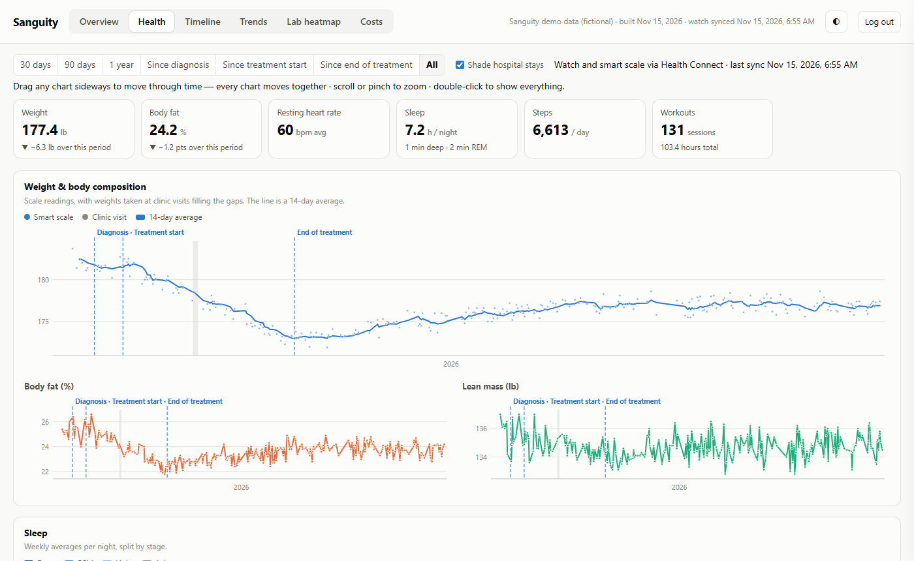

# Sanguity

**Your medical records, insurance claims and wearable data on one private timeline, on your own server.**

Sanguity takes the exports you can download from patient portals and insurers, plus watch and smart-scale
data from your phone, and turns them into one place to see lab trends, visits, hospital stays, documents and
what your care actually cost. It runs on hardware you control; nothing is sent anywhere else.


> **Not medical advice.** Sanguity shows what your records say. It does not diagnose, interpret results or
> recommend treatment. Highlighted values are flagged against the reference ranges in your own lab reports;
> your care team interprets them in context.

All screenshots use the built-in **fictional demo data**. No real person's records appear in this repository.

## What you get

| Tab | What it shows |
|---|---|
| Overview | Key labs with sparklines, watch and scale summaries, active problems, upcoming visits, costs since a milestone |
| Health | Watch and smart-scale data: weight and body composition, sleep stages, steps and workouts, heart rate and HRV |
| Timeline | Every visit, stay, lab draw, report, message, document and claim on one zoomable timeline, with a searchable list |
| Trends | Lab results over time against reference ranges, with procedures, imaging and your milestones marked |
| Lab heatmap | Every draw against its reference range, one row per lab |
| Costs | Insurance claims by month, type of care and provider, and what you actually paid out of pocket |


Charts on Trends, Health and the heatmap move together: drag to pan, scroll or pinch to zoom, double-click to
see everything. **Milestones** (diagnosis, surgery, treatment start…) appear on every chart and as "since"
periods. To track another person today, run a second copy in its own folder with its own
`COMPOSE_PROJECT_NAME` and ports in `.env`; shared multi-person accounts are on the roadmap.

| Health | Timeline | Costs |
|---|---|---|
|  |  |  |

## Install (Docker)

```sh
git clone https://github.com/sanguity/sanguity.git && cd sanguity
cp .env.example .env            # optional: ports, folders, time zone, your user id
docker compose up -d
docker compose logs setup       # shows the first login (user admin and a random password)
```

Open `http://<this machine>:8080`. Until you add your own records it shows the fictional demo.

**Your records:** put each export in its own folder under `RECORDS_DIR` (default `./records`), copy
`sources.example.json` to `sources.json` and describe them, then `docker compose run --rm setup rebuild`.
Optional: `corrections.json` (milestones and hand corrections; see `corrections.example.json`) and
`www/settings.json` (dashboard preferences; see `settings.example.json`).

| Command | What it does |
|---|---|
| `docker compose run --rm setup rebuild` | Rebuild the data after adding or updating exports |
| `docker compose run --rm setup password` | Set or replace the login |
| `git pull && docker compose up -d` | Update Sanguity |

### Supported sources today

| Source | What is read |
|---|---|
| Epic MyChart exports (one primary, any number of others) | Lab and test results, imaging and procedure reports, messages, letters, documents, C-CDA visit records |
| CareSpace / OncoEMR patient portal | Lab results, visits, medications, problems, vitals, documents |
| Insurance claims exports (`uhc`, `bcbs` formats) | Claims, billed / paid / your share, denials |
| Payments export (`payments.json`) | Out-of-pocket payments and premiums |
| Health Connect, via the Life Dashboard Companion phone app | Steps, heart rate, HRV, sleep stages, workouts, weight and body composition |

Standard formats (FHIR, C-CDA labs, Apple Health, CSV) and an import tool in the app are planned; if your
portal's export doesn't import, please open an issue with an anonymised sample.

## Privacy and security

- **Self-hosted only.** Your data stays on your server; Sanguity makes no outside requests and has no telemetry.
- **Login required for everything**, including documents, which are served read-only with scripts blocked.
- **Secrets are generated on first start** (session key, watch-receiver key, a random first password).
- Records, built data, watch data, logins and secrets are never committed (see `.gitignore`).
- Put Sanguity behind HTTPS (a reverse proxy, Tailscale or similar) before using it outside your home network.

## Development

```sh
python3 demo/generate.py                       # fictional demo data into www/
python3 -m http.server -d www 8000             # then open http://127.0.0.1:8000/
pip install playwright && playwright install chromium
python3 tests/browser_check.py                 # the same browser check CI runs on every pull request
```

```
compose.yaml        setup (one-shot), web (nginx) and receiver services
docker/setup.py     First-run secrets and login, data rebuilds, password changes
build.py            Builds www/data.json from the exports listed in sources.json (standard-library Python 3)
lab-aliases.json    Canonical lab names, LOINC codes and other spellings that map onto them
nginx.conf          Web server: cookie login, security headers, read-only /records/ documents
watch/receiver.py   Health Connect webhook receiver: archives payloads, folds them into SQLite, writes public/daily.json
www/                index.html (markup), css/app.css, js/*.js (one plain script per tab, loaded in order), login.html
demo/               Fictional demo dataset generator
tests/              Headless browser check (runs in CI)
*.example.json      Templates for sources.json, corrections.json and www/settings.json; .env.example for .env
```

## License

Sanguity is free software under the [GNU Affero General Public License v3.0](LICENSE). If you run a modified
version for other people, for example as a hosted service, you must offer them its source code.
