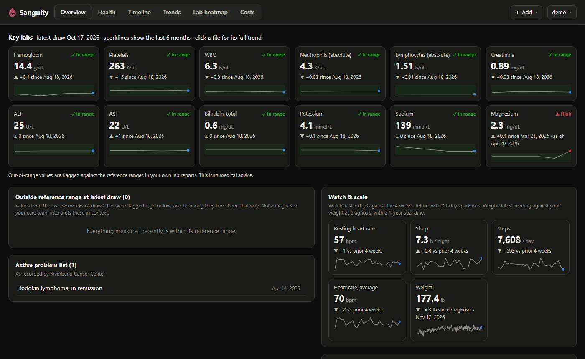
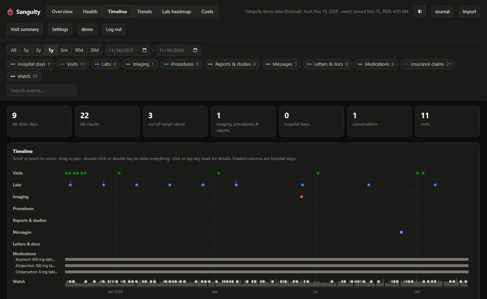

<h1>
  <picture>
    <source media="(prefers-color-scheme: dark)" srcset="docs/logo/sanguity-wordmark-dark.svg">
    
  </picture>
</h1>

**Your medical records, insurance claims and wearable data on one private timeline, on your own server.**

Sanguity takes the exports you can download from patient portals and insurers, plus watch and smart-scale
data from your phone, and turns them into one place to see lab trends, visits, hospital stays, documents and
what your care actually cost. It runs on hardware you control; nothing is sent anywhere else.



> **Not medical advice.** Sanguity shows what your records say. It does not diagnose, interpret results or
> recommend treatment. Highlighted values are flagged against the reference ranges in your own lab reports;
> your care team interprets them in context.

All screenshots use the built-in **fictional demo data**. No real person's records appear in this repository.

## What you get

| Tab | What it shows |
|---|---|
| Overview | Key labs with sparklines, watch and scale summaries, active problems, upcoming visits, costs since a milestone |
| Health | Watch and smart-scale data: weight and body composition, sleep stages, steps and workouts, heart rate and HRV |
| Timeline | Every visit, stay, lab draw, report, message, document and claim on one zoomable timeline, with a searchable list |
| Trends | Lab results over time against reference ranges, with procedures, imaging and your milestones marked |
| Lab heatmap | Every draw against its reference range, one row per lab |
| Costs | Insurance claims by month, type of care and provider, and what you actually paid out of pocket |


Charts on Trends, Health and the heatmap move together: drag to pan, scroll or pinch to zoom, double-click to
see everything. **Milestones** (diagnosis, surgery, treatment start…) appear on every chart and as "since"
periods.

**Several people, one install.** Each person who signs in has their own account, and each person whose health
is tracked has a **profile**. One account can look after several profiles (a parent and a child), and a profile
can be shared with several accounts (a caregiver), each as **owner** (view, change and share), **editor** (view
and change) or **viewer** (view only). Everyone sees only the profiles shared with them; switch between them
from the header.

| Health | Timeline | Costs |
|---|---|---|
|  |  |  |

## Install (Docker)

There are two ways to run it, with the same folders, ports and settings (`.env`):

- **From a release** (`compose.release.yaml`): every service runs the published image,
  `ghcr.io/sanguity/sanguity`, built for x86-64, 64-bit ARM and 32-bit ARM. Nothing to build and no git
  checkout; you upgrade by choosing a newer version. For most installs.
- **From a git checkout** (`compose.yaml`): the image is built on your machine and the code is mounted from the
  checkout, so `git pull` updates it. For following `main` or trying a branch (see also
  [Testing a branch](#testing-a-branch-beside-your-real-install)).

They're two compose files rather than one with an image setting because a checkout install mounts `server/`,
`www/` and the other code from the checkout over whatever is in the image. Pointing it at a released image would
run that release's Python packages with the checkout's code. A released install has no checkout to mount
from, so `compose.release.yaml` mounts only your data folders. The TrueNAS, Unraid and CasaOS templates in
[`deploy/`](deploy/) run the same image.

> No version has been tagged yet. Until the first release, install from a git checkout.

**From a release**, in an empty folder:

```sh
curl -fsSL -o compose.yaml https://github.com/sanguity/sanguity/releases/latest/download/compose.release.yaml
curl -fsSL -o .env https://raw.githubusercontent.com/sanguity/sanguity/main/.env.example   # optional: ports, folders, time zone, your user id
docker compose up -d
docker compose logs app         # shows the one-time setup code
```

The downloaded file starts the version it came from; `SANGUITY_VERSION` in `.env` picks another. Your
`sources.json`, `settings.json` and `corrections.json` go in `./config` (`CONFIG_DIR`), and the encryption key is
kept in `./auth` (`AUTH_DIR`), apart from the data.

**From a git checkout:**

```sh
git clone https://github.com/sanguity/sanguity.git && cd sanguity
cp .env.example .env            # optional: ports (default 8730 web, 8731 phone uploads), folders, time zone, your user id
docker compose up -d --build
docker compose logs app         # shows the one-time setup code
```

**Platforms:** x86-64 and 64-bit ARM (a Raspberry Pi 3, 4 or 5 on 64-bit Raspberry Pi OS) install prebuilt
packages, so the first build takes a minute or two. 32-bit ARM (a Pi on a 32-bit OS) works too, and CI checks it
every week, but the first build compiles several packages, including `cryptography` with Rust, which can take an
hour or more on the Pi itself (a Pi with 1 GB of memory may need swap). Later builds reuse it until
`requirements.txt` changes. The released image is already built for all three.

Open `http://<this machine>:8730` and enter the setup code to create the first account. It becomes the admin
and owns the records already on the server; until you add your own, that is the fictional demo. Add accounts for
other people under **Account**, then share profiles with them there.

**Your records:** put each export in its own folder under `RECORDS_DIR` (default `./records`), copy
`sources.example.json` to `sources.json` and describe them, then `docker compose run --rm setup rebuild`; the first profile picks up the rebuild automatically.
Optional: `corrections.json` (your milestones; see `corrections.example.json`) and `settings.json` (that profile's
dashboard preferences; see `settings.example.json`). On a checkout install all three go next to `compose.yaml`;
on a release install, in `./config`. Corrections to events are made in
the app (see [Correcting records](#correcting-records)); an older `corrections.json`'s `not_hospital_stays` are moved
into the app once, at the first start of a version that has them, and aren't read from the file after that.

| Command | What it does |
|---|---|
| `docker compose run --rm setup rebuild` | Rebuild the data after adding or updating exports |
| `docker compose exec app python -m server.manage reset-password NAME` | One-time password for a locked-out account |
| `docker compose exec app python -m server.manage list` | Accounts, profiles and who has which role |
| `docker compose exec app python -m server.manage remove-user NAME --hand-to OTHER` | Delete an account for good (also under **Account**); profiles only it owned go to OTHER |
| `docker compose exec app python -m server.manage disable-2fa NAME` | Turn off two-factor sign-in for someone who lost their phone and recovery codes |
| `git pull && docker compose pull --ignore-buildable && docker compose build --pull && docker compose up -d` | Update a checkout install, and the images it runs on |

### Updating

**Database migrations run at start-up.** Each time the app starts, it upgrades its database to the version it
needs (`server/db.py`): every schema step not yet applied runs in order, each in a transaction. Other changes a
release makes to stored data (such as records moving into the database, below) happen the same way. There is no
separate migrate command. Going back to an older version isn't supported: restore the backup you took before
upgrading instead. [`CHANGELOG.md`](CHANGELOG.md) lists what each release changes and anything to do when
upgrading to it. CI checks every change by upgrading the previous release's data with it.

**A release install:** back up, then pick the new version and start it:

```sh
docker compose exec app python -m server.manage backup
curl -fsSL -o compose.yaml https://github.com/sanguity/sanguity/releases/latest/download/compose.release.yaml   # or set SANGUITY_VERSION in .env
docker compose pull && docker compose up -d
```

Read the **Upgrade notes** in `CHANGELOG.md` for every release since yours first. Each release image is built on
the Python and Alpine images of its day, so upgrading also brings their security patches.

**A checkout install:** run the update command in the table above at least once a month, and soon after a
security fix is announced (watch the repository's releases). Besides the code, it pulls the newest nginx image and
rebuilds the app on the newest Python base image, so the operating system and Python get their security patches;
`docker compose up -d --build` alone keeps the images of the day you installed. It needs Docker Compose 2.15 or
later (`docker compose version`). Dependency updates are proposed weekly in this repository by Dependabot
(`.github/dependabot.yml`) and arrive with `git pull`. To follow releases rather than `main`, check out a tag:
`git fetch --tags && git checkout v1.2.0`.

### Upgrading to a release

To move a checkout install onto the published image, keeping its data, key and settings:

1. Back up: `docker compose exec app python -m server.manage backup`.
2. Stop it: `docker compose down`.
3. In the checkout folder, move your configuration into `./config`:
   `mkdir -p config && for f in sources.json settings.json corrections.json; do [ -f "$f" ] && mv "$f" config/; done`.
   `auth/`, `data/`, `backups/`, `watch-data/` and `records/` stay where they are (or wherever `.env` points).
4. Download the release's compose file into the same folder and start it:
   `curl -fsSL -O https://github.com/sanguity/sanguity/releases/latest/download/compose.release.yaml`, then
   `docker compose -f compose.release.yaml up -d`. `.env` is read as before. The project name is the same, so the
   new containers replace the old ones.

Documents kept in an older install's `www/files*/` (sources.json `"files"`) are only served by a checkout install;
stay on `compose.yaml` until they're imported.

**Upgrading from a version without accounts:**

- The old single login (`auth/htpasswd`) no longer works. After updating, `docker compose logs app` shows a setup
  code; the account you create with it owns your existing records.
- The default ports changed from 8080 and 8081 (often taken by other apps) to **8730** for the web app and **8731**
  for the phone app's uploads. If you relied on the old defaults, either keep them by adding `WEB_PORT=8080` and
  `RECEIVER_PORT=8081` to `.env`, or update your bookmarks, reverse proxy and the upload address in the phone app.
  Otherwise watch data quietly stops arriving.

**Records move into the database:** each profile's records used to be one file, `DATA_DIR/profiles/<id>/data.json`.
On the first start after updating they are loaded into the database, with nothing to do and nothing that looks
different; the file stays beside them as `data-before-v10.json`, and can be deleted once you've checked the app.

### Supported sources today

| Source | What is read |
|---|---|
| Epic MyChart exports (one primary, any number of others) | Lab and test results, imaging and procedure reports, messages, letters, documents, C-CDA visit records |
| CareSpace / OncoEMR patient portal | Lab results, visits, medications, problems, vitals, documents |
| Insurance claims exports (`uhc`, `bcbs` formats) | Claims, billed / paid / your share, denials |
| Payments export (`payments.json`) | Out-of-pocket payments and premiums |
| Health Connect, via the Life Dashboard Companion phone app | Steps, heart rate, HRV, sleep stages, workouts, weight and body composition |
| Typed in by hand on the import page (**Type them in**) | Lab results, visits, hospital stays, procedures, imaging and reports, medications and pharmacy fills, problems and diagnoses, insurance claims, out-of-pocket payments, upcoming appointments, vitals, home weight and steps, workouts, letters and documents with a PDF or picture |

Standard formats (FHIR, C-CDA labs, Apple Health, CSV) and an import tool in the app are planned; if your
portal's export doesn't import, please open an issue with an anonymised sample, or write an importer for it:
[docs/importers.md](docs/importers.md) explains how (one Python file and a fictional test fixture).

### Uploading records in the app

**Import** (in the header, or on an empty profile) uploads a portal's or app's export to a profile you own or edit:
a zip as you downloaded it, a folder you've unpacked (its folders are kept), or single files. Viewers can't upload.
Each file streams to the server on its own, with progress, and is kept in the profile's folder encrypted, as the
import's original files: they're included in **Export everything** and in backups, and go when the profile is
deleted. A zip is unpacked on the server, never in the browser; zips inside it stay zips. Reading the uploaded
records into the profile comes next.

Limits, in `.env`: `UPLOAD_MAX_FILE_MB` (each file, sent or unpacked; 4096), `UPLOAD_MAX_TOTAL_MB` (one upload
altogether, after unpacking; 16384) and `UPLOAD_MAX_FILES` (20000). nginx lets a file through up to 4 GB; to go
higher, raise `client_max_body_size` in `nginx.conf` too. Refused: paths that are absolute or go up a folder
(`..`), and zips holding links, such paths, more files or bytes than the limits, or a file that unpacks to more
than `UPLOAD_MAX_ZIP_RATIO` (200) times its compressed size (a zip bomb). An upload left unfinished for a day is
removed when the app next starts. While an import reads an upload, a decrypted copy sits in the app container's
`/tmp`, which is in memory, and is removed straight after.

### Typing records in

For records on paper, or from a portal that has no export, **Type them in** on the import page takes every kind of
record Sanguity can import. Lab results go one per row, as in a spreadsheet (and rows copied from one can be pasted
in); everything else has a form of its own, picked from **Add a record**: a visit, a hospital stay, a procedure, an
imaging scan or a report, a medication or a pharmacy fill with its cost, a problem or diagnosis, an insurance claim,
an out-of-pocket payment, an upcoming appointment, vitals taken at a visit (blood pressure, heart rate, temperature,
height, SpO2, breathing rate, weight), a weight or step count measured at home, a workout, or a letter or document
with its PDF or picture attached. Dates take the forms a lab spreadsheet does (`2026-03-04`, `4 Mar 2026`, and
`03/04/2026` when the other dates settle which is the day).

Each entry is checked as you type and says what it will become, or which field is wrong and why; one the profile has
already is pointed out and left out of the save unless you tick **Save again what's already there**. **Save** stores
everything as one import, which shows wherever imported records do (the timeline and its panel, Trends, Health and
Costs) and can be undone from the import history as a whole, the attached files and the home measurements included.
Owners and editors only. An attached file is sent as an upload, so the upload limits above apply to it; it is kept
encrypted like any other.

### Correcting records

Portals get things wrong: an outpatient scan coded as a hospital stay, a visit filed on the wrong day, the same
appointment twice. Owners and editors fix them in the event's panel (click it on the timeline): **Hide**,
**Rename**, **Fix date**, **Not a hospital stay** (for stays) or **Merge with…** another event within a week, which
folds that event into the open one: the open one keeps its own title, date and details, gains the details it was
missing, and takes over the other's cost row. An edited event says **Edited**, with what changed and who changed
it, to everyone who can see the profile; owners and editors can undo it there, and **All edits** lists every edit,
including those whose event is no longer in the records ("not found in the current records": its import was
undone, or the source changed it). Each edit and undo is in the profile's activity log.

Edits belong to the profile, not to an import: undoing an import, importing the same records again, or rebuilding
the setup build keeps them, and they apply again to the same events. They find an event by its source key (see
[docs/importers.md](docs/importers.md#source-keys)) or, for the setup build's events, which have none, by its kind,
start time and title. Like the records, they are encrypted at rest. `corrections.json` now holds **milestones
only**; editing those in the app comes with Phase 3 (#39).

## Privacy and security

- **Self-hosted only.** Your data stays on your server; Sanguity makes no outside requests and has no telemetry.
  Planned sign-in to providers' and insurers' APIs will be opt-in, through an app each install registers with
  the vendor itself (decided in [docs/connected-sources-oauth.md](docs/connected-sources-oauth.md)).
- **Accounts with Argon2id-hashed passwords** (at least 15 characters, per NIST SP 800-63B; passwords found in
  public breaches are refused, checked against a bundled list on your server, see `server/passwords/`). Password and
  recovery-code hashes are peppered with a server secret that only the encryption key unlocks, so a copied database
  alone can't be used to guess them. Sign-in throttling,
  and server-side sessions you can see and sign out under **Account**. A sign-in lasts 30 days on an account with
  a second factor and 12 hours on one without (`SESSION_DAYS`, `SESSION_HOURS_WITHOUT_2FA` in `.env`); optionally
  sign people out after a period of inactivity too (`SESSION_IDLE_MINUTES`).
- **Two-factor sign-in** with an authenticator app (codes that can't be reused) and one-time recovery codes, under
  **Account**; admins can require it for everyone. With it on, a password may be as short as 8 characters.
- **Passkeys** (Face ID, Touch ID, Windows Hello, a phone or a security key), under **Account**: sign in with one on
  its own, or use it as the step after the password. They need HTTPS; see [Passkeys](#passkeys).
- **Every request for records or documents checks the account's role on that profile.** Documents are served
  only through that check, read-only, with scripts blocked; no folder of health data is served directly.
- **Admins manage accounts, not records:** being an admin doesn't show anyone's records.
- **Admins need a second factor:** once the server has more than one account, an admin needs an authenticator app
  or a passkey on their own account to use any admin action under **Account**; until then the page says to set one
  up. A one-person install (one admin, no other accounts) is exempt. Resetting someone's password, turning off their
  two-factor sign-in or making someone an admin also asks the admin to confirm it's them (password, code or passkey)
  unless they did so, or signed in, within the last 5 minutes (`REAUTH_MINUTES` in `.env`). The command line
  (`server.manage`) needs neither, so it stays the way back in, for example after an admin loses their phone.
- **Export everything:** owners and editors can download a profile as one zip (records, documents, settings, watch
  data, uploaded files and activity) under **Account**, and load it into another install with `server.manage create-profile` and
  `import`.
- **Delete profile:** an owner can delete a profile and everything in it under **Account**, after typing its name;
  the original exports and older backups are left alone.
- **Activity log:** each profile's owners can see who opened its records and documents, and who shared, renamed or
  changed it, and when (**Account > Activity**); admins see account changes. Entries are kept for a year
  (`ACTIVITY_DAYS` in `.env`).
- **Encrypted at rest** (AES-256-GCM): records, documents, settings and the sensitive database fields are
  unreadable without the key in `auth/data_key`, so a copied data folder or backup gives nothing away. See
  [Encryption at rest](#encryption-at-rest).
- **Secrets are generated on first start** (encryption key, watch-receiver key, a one-time setup code).
- Records, built data, watch data, logins and secrets are never committed (see `.gitignore`).
- **Failed sign-ins:** they're throttled and logged, and admins see a notice under **Account** when one address or
  account fails 10 times in a day, or 30 failures pile up in all. Nothing is sent outside the server.
- **Put Sanguity behind HTTPS** (a reverse proxy, Tailscale or similar) before using it outside your home network;
  Sanguity itself serves plain HTTP on `WEB_PORT`, and the sign-in and Account pages warn when they're opened that
  way from outside the home network or a tailnet. Behind your proxy:
  - set `COOKIE_SECURE=1` in `.env`, so the sign-in cookie is never sent over plain HTTP (the default, `auto`,
    relies on the proxy sending `X-Forwarded-Proto: https`);
  - turn on HSTS at the proxy (`Strict-Transport-Security: max-age=31536000`), so browsers refuse plain HTTP to that
    name; Sanguity can't send it itself, since it never sees the HTTPS connection;
  - if sign-in says "Request refused (cross-site check)", set `PUBLIC_ORIGINS` in `.env` to the address you open it
    at; to see visitors' real addresses on the device list, trust your proxy in `nginx.conf` (see the comment there).

### Passkeys

A passkey belongs to the name you open Sanguity at, so it works only:

- **over HTTPS** (or at `http://localhost`): browsers don't offer passkeys to a plain-HTTP address;
- **at a name, not an IP address**: `https://health.example.com` or a Tailscale name works, `http://192.168.1.20:8730`
  doesn't. Put Sanguity behind a reverse proxy with a certificate (Caddy, Nginx Proxy Manager, Traefik, Tailscale
  Serve) and add that address to `PUBLIC_ORIGINS` in `.env`;
- **at the name it was added at**: one added at `https://health.example.com` isn't offered at another name for the
  same server. **Account > Passkeys** shows where each one works.

Your password keeps working alongside passkeys. Where an admin requires two-factor sign-in, your last second step
(the only passkey, with no authenticator app) can't be removed, so nobody locks themselves out. An admin's
**Turn off 2FA** (or `server.manage disable-2fa NAME`) removes the authenticator app and every passkey, for someone
who lost the phone holding them.

## Backup and restore

Health records are worth more than uptime: keep copies off this machine.

**What to back up**

| What | Where | How |
|---|---|---|
| Accounts, profiles, records as loaded | `DATA_DIR` (default `./data`) | `docker compose exec app python -m server.manage backup` writes one checked archive to `BACKUP_DIR` (default `./backups`), safe while the app runs; `--keep 14` keeps the newest 14 |
| Your original exports | `RECORDS_DIR` | copy them; Sanguity only reads them |
| Watch and scale data | `WATCH_DIR` | `watch.db` plus `raw/`, the receiver's archive of every upload (`receiver.py --reprocess` rebuilds the database from it); encrypted, so they need `auth/data_key` too |
| Secrets and configuration | `auth/`, `.env`, `sources.json`, `corrections.json`, `settings.json` | copy them; keep `auth/data_key` somewhere other than the backups (see below) |

Run the backup every night, for example from cron on the host (on TrueNAS: **System > Advanced > Cron Jobs**):

```sh
0 3 * * * cd /path/to/sanguity && docker compose exec -T app python -m server.manage backup --keep 14
```

ZFS snapshots of these folders are fine too: SQLite recovers from a snapshot as from a power cut. The archive is
still worth having, since it can be checked (`python -m server.manage verify FILE`) and copied anywhere.

**Restore** with the app stopped; the data it replaces is moved to `DATA_DIR/before-restore-<time>/`, not deleted,
and a backup from an older version is upgraded when the app starts:

```sh
docker compose stop app web
docker compose run --rm --no-deps app python -m server.manage restore /backups/sanguity-backup-YYYYMMDD-HHMMSS.tar.gz
docker compose up -d
```

**Restoring on another machine** needs the `auth/data_key` the backup was made with: put it in place first.
A restore checks the backup opens with the key before replacing anything.

### Encryption at rest

The setup service makes a key on first start, `auth/data_key`, and the app encrypts with it everything it keeps in
`DATA_DIR`: each profile's settings, documents and uploaded files, the setup build, and the database fields that hold the records
themselves, document names, activity details and two-factor secrets, and the pepper that password and recovery-code hashes are
made with. The watch receiver encrypts what it keeps in `WATCH_DIR`
with the same key: its archive of uploads (`raw/`), its database (`watch.db`, a sealed snapshot of the copy it keeps
in memory) and the daily summary the app shows. An existing install is encrypted on its first start after
updating. The key is mounted read-only into the app and the receiver, and is never in `DATA_DIR`, `WATCH_DIR` or a
backup.

- **Back up the key file on its own** (a password manager, a USB stick in a drawer). Without it the data and every
  backup are unreadable, and nobody can recover them, or sign in: passwords are checked with the pepper it unlocks. With it, a stolen backup is as readable as without encryption,
  so keep the two apart.
- **Keeping the key elsewhere:** the app and the receiver read whatever file `SANGUITY_KEY_FILE` names, so it can be
  a Docker or Podman secret (`/run/secrets/<name>`), a systemd credential (`$CREDENTIALS_DIRECTORY/<name>`) or a
  file on another encrypted disk. Make the key once with the setup service, move it there, and point
  `SANGUITY_KEY_FILE` at it for both services in a `compose.override.yaml`. The key is still read into the app's
  memory while it runs; Sanguity doesn't use a hardware security module.
- **Not covered:** account and profile names; your original exports in `RECORDS_DIR` (only read, never copied in
  plaintext); downloads from **Export everything** (portable on purpose).
- **For a stolen disk or server,** also encrypt the disk, which covers those too: an encrypted ZFS dataset (TrueNAS),
  LUKS (Linux), FileVault (macOS) or BitLocker (Windows). The key file sits in the Sanguity folder, so on a disk that
  isn't encrypted it is next to the data.
- **Rotate the key** (for example after a copy of `auth/` may have leaked):

  ```sh
  docker compose run --rm setup python3 -I /app/docker/setup.py new-key   # adds a new first line to auth/data_key
  docker compose restart app receiver   # each re-encrypts its files with the new key as it starts
  ```

  When `docker compose logs app receiver` shows both have started, delete the old (second) line from `auth/data_key`. Backups made before then still need the old key.
  Passwords and recovery codes keep working: the pepper is re-encrypted with the new key, never changed.

## Testing a branch beside your real install

`docker/dev-stack.sh` runs a separate test copy from any branch on the same machine: its own compose project
(`sanguity-dev`), ports (8740 and 8741 by default) and folders, so the real install is never touched. Your record
exports and watch summary can be shown read-only, or it uses the demo data.

```sh
curl -fsSLO https://raw.githubusercontent.com/sanguity/sanguity/main/docker/dev-stack.sh
sudo bash dev-stack.sh --dir /mnt/POOL/apps/sanguity-dev                       # main, demo data
sudo bash dev-stack.sh --dir /mnt/POOL/apps/sanguity-dev --branch my-feature   # switch to a branch (also: update)
sudo bash dev-stack.sh --dir /mnt/POOL/apps/sanguity-dev --records /path/to/exports     --watch-public /path/to/watch-data/public --watch-key /path/to/auth/data_key --puid UID --pgid GID   # your data, read-only
```

`--watch-key` is the real install's key file: the watch summary is encrypted with it, so the test copy adds it to
its own key file, after its own key, only to read the summary. With `--records`, put your `sources.json` (and `corrections.json` / `settings.json` if you use them) in the
test copy's `config/` folder. `--down` stops it, `--logs` follows its logs, `--reset` starts it over; `--help`
lists everything.

On TrueNAS the script works without sudo: when Docker isn't reachable it deploys the test copy as a custom app
(it appears on the Apps page and starts with the server), and the setup code is in its `data/setup-code.txt`.
Keep `--dir` private (for example mode 750) when it holds a copy of your records.

## Development

```sh
pip install --require-hashes -r requirements-dev.txt && playwright install chromium   # exact, hash-checked versions
python3 -I demo/generate.py dev-data/build --watch dev-data/watch    # fictional demo data
SANGUITY_DATA=dev-data SANGUITY_KEY_FILE=dev-keys/data_key SANGUITY_RECORDS=dev-data/records SANGUITY_WATCH_FILE=dev-data/watch/daily.json   SANGUITY_SERVE_STATIC=1 PORT=8000 python3 -m server               # then open http://127.0.0.1:8000/ (setup code in the output)
python3 tests/test_api.py                      # API tests: sign-in, sessions, roles, sharing, documents
python3 tests/test_uploads.py                  # upload tests: roles, refused paths and zips, limits, encryption
python3 -m unittest discover -s tests -p "test_importer*.py"   # importers and their fixtures, build.py output
python3 tests/browser_check.py                 # the same browser check CI runs on every pull request
docker compose up -d --build && python3 tests/docker_smoke.py --code <setup code from docker compose logs app>
                                               # the whole install through nginx, as CI does too
```

```
compose.yaml        setup (one-shot), app (the API), web (nginx) and receiver services, built from this checkout
compose.release.yaml The same services on the published image, ghcr.io/sanguity/sanguity (no checkout needed)
CHANGELOG.md        What each release changes, with upgrade notes; release.yml publishes a release from a v* tag
deploy/             Install templates for the TrueNAS, Unraid and CasaOS app catalogs, and deploy/check.py
server/             The API (FastAPI + SQLite): accounts, sessions, profiles, roles, records and documents;
                    its database design, with diagrams, is in docs/database.md
server/importers/   One module per record format, the registry that picks one, shared helpers (docs/importers.md)
requirements.in     The API's dependencies; requirements.txt and requirements-dev.txt are their pinned,
                    hash-checked lock files (regenerate with uv, as requirements.in says; Dependabot proposes
                    updates weekly, and CI checks the locks match)
docker/setup.py     First-run secrets and folders, data rebuilds
docker/allinone.py  The published image's default command: every service in one container (the Unraid template)
docker/dev-stack.sh A test copy from any branch beside a real install (see above)
build.py            Builds a profile's data.json from the exports listed in sources.json (standard-library Python 3)
lab-aliases.json    Canonical lab names, LOINC codes and other spellings that map onto them
nginx.conf          Web server: the app's pages and security headers; passes /api/ to the app
watch/receiver.py   Health Connect webhook receiver: archives payloads, folds them into SQLite, writes public/daily.json
www/                index.html (markup), css/app.css, js/*.js (one plain script per tab, loaded in order),
                    login.html, setup.html (first account), account.html (password, devices, profiles, accounts),
                    import.html (uploading a portal's export)
demo/               Fictional demo dataset generator
tests/              API and upload tests, a headless browser check and a smoke test of the Docker install (all run in CI)
*.example.json      Templates for sources.json, corrections.json (milestones) and settings.json; .env.example for .env
```

## License

Sanguity is free software under the [GNU Affero General Public License v3.0](LICENSE). If you run a modified
version for other people, for example as a hosted service, you must offer them its source code.
