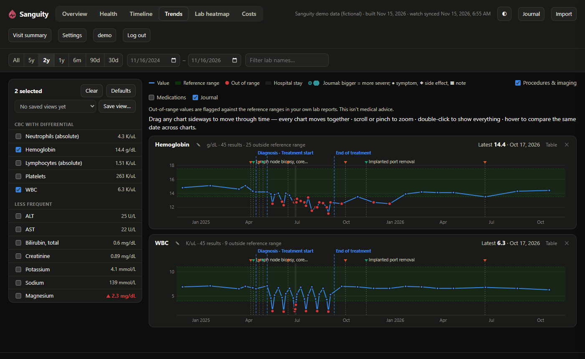
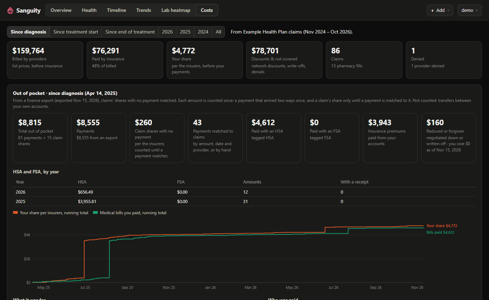
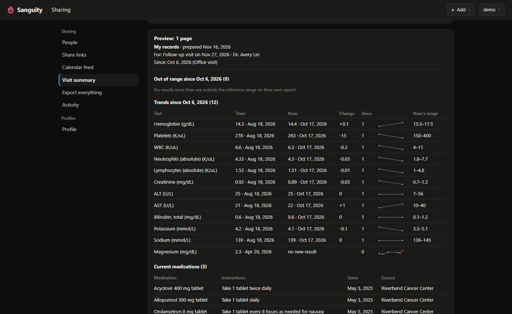
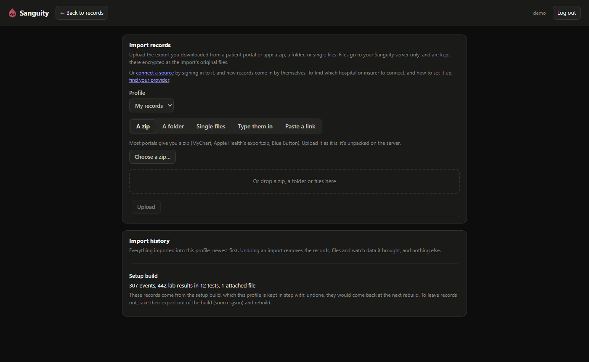
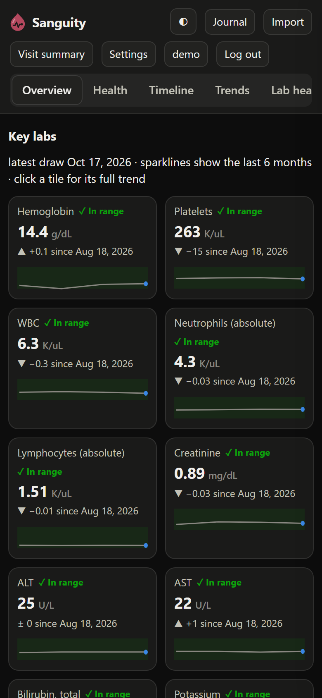
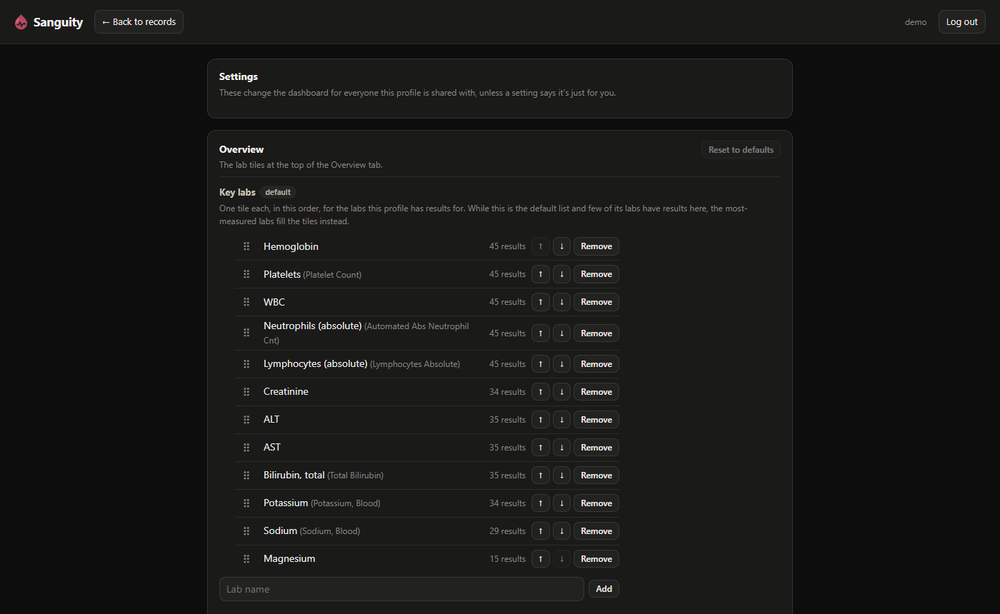

<h1>
  <picture>
    <source media="(prefers-color-scheme: dark)" srcset="docs/logo/sanguity-wordmark-dark.svg">
    
  </picture>
</h1>

**Your medical records, insurance claims and wearable data on one private timeline, on your own server.**

Sanguity brings together what your patient portals, insurers, phone and watch know about you: lab trends, visits,
hospital stays, medications, documents and what your care actually cost. Upload the exports you can download, or
connect a portal or health plan once and let new records arrive by themselves. It runs on hardware you control,
encrypts what it keeps, and talks to no one you haven't connected.


> **Not medical advice.** Sanguity shows what your records say. It does not diagnose, interpret results or
> recommend treatment. Highlighted values are flagged against the reference ranges in your own lab reports
> (or, for a result whose report gives none, a range you set yourself, labelled "range from settings"); your care
> team interprets them in context.

All screenshots use the built-in **fictional demo data** (`python3 tools/screenshots.py` takes them again). No real
person's records appear in this repository.

## What you get

| Tab | What it shows |
|---|---|
| Overview | Key labs with sparklines, watch and scale summaries, active problems, allergies, immunizations, upcoming visits, costs since a milestone |
| Body and activity | Watch, sleep and smart-scale data: weight and body composition, sleep stages, steps and workouts (with heart rate zones from the age or a measured maximum), heart rate and HRV; blood pressure, body temperature, blood oxygen and respiratory rate taken at home beside the readings taken at visits; cardio fitness (VO2 max) as the watch estimates it; blood glucose from a meter or a continuous glucose monitor (CGM), with time in the standard ranges; BMI over time; a child's growth charts (WHO and CDC percentiles) |
| Timeline | Every visit, stay, lab draw, report, immunization, message, document and claim on one zoomable timeline, with a searchable list; each medication as spans from its start through dose changes to its stop, with pharmacy fills marked |
| Labs | Lab results against reference ranges, as charts over time (each with a table of its values), with procedures, imaging and your milestones marked, and saved views of the labs you chart together; or as a heatmap of every draw, one row per lab; a name filter beside the list of labs narrows either; "What is this test?" beside a lab links to a plain-language page about the test (MedlinePlus) |
| Costs | Insurance claims by month or year, type of care and provider, and what you actually paid out of pocket: typed in, exported or from claims, matched to claims, counted once, with HSA and FSA totals |



One period, in the bar above the records, holds on every tab with time: All, the last 5 years down to 30 days, since
a milestone, a calendar year (under **More…**), or dates of your own (**More… → Custom dates…**). Charts on Labs and Body and activity move together: drag to pan,
scroll or pinch to zoom, double-click to see everything. Every chart can be shown as a table instead (Chart | Table
beside it; the Timeline's list is its table), the Labs and Body and activity charts can be stepped through with the
arrow keys, and an out-of-range result is marked ▲ or ▼ as well as coloured. **Milestones** (diagnosis, surgery, treatment start…), added
on the **Settings** page, appear on every chart and as "since" periods.

| Body and activity | Timeline | Costs |
|---|---|---|
|  |  |  |

**Getting records in**

- **Upload** a portal's or app's export under **Sources** (a zip, a folder or single files): Epic MyChart,
  C-CDA, FHIR (Apple Health, Blue Button, portals), lab spreadsheets and Quest or Labcorp PDFs, insurers' claims, and
  more ([sources below](#supported-sources-today)). Each import is previewed before it's saved, can be undone from
  the import history, and records the same result from two sources once.
- **Connect** a patient portal (SMART on FHIR, Epic first) or a health plan's patient-access API once; new records
  then come in on a schedule ([Connected sources](#connected-sources)).
- **Type records in** by hand, paste a SMART Health Link, and **correct** anything an import got wrong; corrections
  survive re-imports.
- **Phones:** watch and smart-scale data from Android (Health Connect, via Life Dashboard Companion) or iPhone
  (Apple Health, via Health Auto Export), which covers Garmin, Fitbit, Withings and most others
  ([Connecting a phone](#connecting-a-phone-watch-and-scale-data)).

**Making it yours**

- **Settings** per profile: the Overview's key-lab tiles, the tabs shown and their order, saved Labs views, lab
  and source nicknames (rename anything with the ✎ where it's shown), milestones, visits counted as workouts, your
  own reference ranges for results without one, and, per person, units (exact conversions only), time zone, date
  format and a light or dark theme.
- A **journal** of symptoms, side effects and notes, on the timeline and the charts, listed on the Timeline tab:
  your own symptom groups logged in one go, where on the body (a front and back outline, or a list), photos with
  their location data taken out, a day's mood and energy in a lane of their own, and a body map of where symptoms
  have been.
- A **medication log** (#235): doses taken, taken late or skipped, logged from a medication's details or the
  Overview's "Today's medication doses" (with the reminder times set on it, #162), on the medication's span on the
  timeline and, when ticked, under the Labs charts, with a weekly count of what was logged. Apple Health's Medications
  doses come in through Health Auto Export; it records what you say happened and never says a dose was due.

**Finding your way.** One bar across the top: your records' tabs, **Add** (upload files, connect a portal or plan, type
records in, paste a Health Link, a journal entry) and your menu (sources, sharing, settings, account, light or dark,
log out). The tab shown is in the address (`#timeline`, `#labs`, `#labs-heatmap`...), so Back moves between tabs and a
copied link opens the same one. **Settings** is grouped in a sidebar (this profile's dashboard, labs and ranges, milestones; your display),
one group at a time, with **Find a setting** to search them all.
**Account** is you and this device: sign-in and security (password, two-factor sign-in, passkeys, where you're
signed in), and this device (install as an app, offline records).
**Sources** (in your menu) has everything about records coming in, in a sidebar the same way: an overview of every
way records reach the profile and when each last brought something, upload, type in, paste a Health Link, portals
and health plans, the phone and watch, and the import history.
**Sharing** gathers everything about who sees a profile and how its records go out: its people and their roles,
share links, your calendar feed, the visit summary, Export everything and its activity, with renaming, deleting and
adding profiles set apart under Profile, beside About this person (birth date, sex for reference ranges, height).
The **profile** a page is about is in the top bar, by name and your role, on the records, Sources, Sharing and
Settings; switching it there switches it on every page.

**Sharing and taking it with you**

- **Several people, one install.** Each person who signs in has their own account, and each person whose health is
  tracked has a **profile**. One account can look after several profiles (a parent and a child), and a profile can
  be shared with several accounts (a caregiver), each as **owner**, **editor** or **viewer**.
- **Share links**: a read-only, expiring link to chosen parts of a profile for a clinician or relative, revocable
  any time, every view logged ([Share links](#share-links)).
- A printable **visit summary** (PDF) to bring to an appointment: what's out of range since the last visit, trends,
  current medications, upcoming appointments and your own questions.
- **Calendar reminders**: upcoming appointments and expected lab draws in your own calendar app.
- **Install as a phone app** from the browser, with offline reading if you turn it on.

| Visit summary | Import | On a phone |
|---|---|---|
|  |  |  |



## Install (Docker)

There are two ways to run it, with the same folders, ports and settings (`.env`):

- **From a release** (`compose.release.yaml`): every service runs the published image,
  `ghcr.io/sanguity/sanguity`, built for x86-64, 64-bit ARM and 32-bit ARM. Nothing to build and no git
  checkout; you upgrade by choosing a newer version. For most installs.
- **From a git checkout** (`compose.yaml`): the image is built on your machine and the code is mounted from the
  checkout, so `git pull` updates it. For following `main` or trying a branch (see also
  [Testing a branch](#testing-a-branch-beside-your-real-install)).

They're two compose files rather than one with an image setting because a checkout install mounts `server/`,
`www/` and the other code from the checkout over whatever is in the image. Pointing it at a released image would
run that release's Python packages with the checkout's code. A released install has no checkout to mount
from, so `compose.release.yaml` mounts only your data folders. The TrueNAS, Unraid and CasaOS templates in
[`deploy/`](deploy/) run the same image.

> No version has been tagged yet. Until the first release, install from a git checkout.

**From a release**, in an empty folder:

```sh
curl -fsSL -o compose.yaml https://github.com/sanguity/sanguity/releases/latest/download/compose.release.yaml
curl -fsSL -o .env https://raw.githubusercontent.com/sanguity/sanguity/main/.env.example   # optional: ports, folders, time zone, your user id
docker compose up -d
docker compose logs app         # shows the one-time setup code
```

The downloaded file starts the version it came from; `SANGUITY_VERSION` in `.env` picks another. Your
`sources.json`, `settings.json` and `corrections.json` go in `./config` (`CONFIG_DIR`), and the encryption key is
kept in `./auth` (`AUTH_DIR`), apart from the data.

**From a git checkout:**

```sh
git clone https://github.com/sanguity/sanguity.git && cd sanguity
cp .env.example .env            # optional: ports (default 8730 web, 8731 phone uploads), folders, time zone, your user id
docker compose up -d --build
docker compose logs app         # shows the one-time setup code
```

**Platforms:** x86-64 and 64-bit ARM (a Raspberry Pi 3, 4 or 5 on 64-bit Raspberry Pi OS) install prebuilt
packages, so the first build takes a minute or two. 32-bit ARM (a Pi on a 32-bit OS) works too, and CI checks it
every week, but the first build compiles several packages, including `cryptography` with Rust, which can take an
hour or more on the Pi itself (a Pi with 1 GB of memory may need swap). Later builds reuse it until
`requirements.txt` changes. The released image is already built for all three.

Open `http://<this machine>:8730` and enter the setup code to create the first account. It becomes the admin
and owns the records already on the server; until you add your own, that is the fictional demo. With no records
on the server yet, the **Getting started** guide opens next: it names the profile, brings in its first records and,
if you like, connects a phone; every step can be skipped, and the guide stays in your menu. Add accounts for
other people under **Admin** (in your menu, for admins), then share profiles with them under **Sharing → People**.

**Your records:** put each export in its own folder under `RECORDS_DIR` (default `./records`), copy
`sources.example.json` to `sources.json` and describe them, then `docker compose run --rm setup rebuild`; the first profile picks up the rebuild automatically.
Dashboard preferences (key labs, lab nicknames, visits counted as workouts, milestones...) are changed on the
**Settings** page, per profile; a `settings.json` (on a checkout install next to `compose.yaml`, on a release
install in `./config`; see
`settings.example.json`) only gives a new profile linked to the build its first settings, and a rebuild never
changes settings made in the app (the log says when the file differs from them). Corrections to events are made in
the app (see [Correcting records](#correcting-records)). `corrections.json` is no longer needed: an older one's
`not_hospital_stays` and milestones are moved into the app once, at the first start of a version that has them,
and aren't read from the file after that (see `corrections.example.json`).

| Command | What it does |
|---|---|
| `docker compose run --rm setup rebuild` | Rebuild the data after adding or updating exports |
| `docker compose exec app python -m server.manage reset-password NAME` | One-time password for a locked-out account |
| `docker compose exec app python -m server.manage list` | Accounts, profiles and who has which role |
| `docker compose exec app python -m server.manage remove-user NAME --hand-to OTHER` | Delete an account for good (also under **Admin**); profiles only it owned go to OTHER |
| `docker compose exec app python -m server.manage disable-2fa NAME` | Turn off two-factor sign-in for someone who lost their phone and recovery codes |
| `git pull && docker compose pull --ignore-buildable && docker compose build --pull && docker compose up -d` | Update a checkout install, and the images it runs on |

### Updating

**Database migrations run at start-up.** Each time the app starts, it upgrades its database to the version it
needs (`server/db.py`): every schema step not yet applied runs in order, each in a transaction. Other changes a
release makes to stored data (such as records moving into the database, below) happen the same way. There is no
separate migrate command. Going back to an older version isn't supported: restore the backup you took before
upgrading instead. [`CHANGELOG.md`](CHANGELOG.md) lists what each release changes and anything to do when
upgrading to it. CI checks every change by upgrading the previous release's data with it.

**A release install:** back up, then pick the new version and start it:

```sh
docker compose exec app python -m server.manage backup
curl -fsSL -o compose.yaml https://github.com/sanguity/sanguity/releases/latest/download/compose.release.yaml   # or set SANGUITY_VERSION in .env
docker compose pull && docker compose up -d
```

Read the **Upgrade notes** in `CHANGELOG.md` for every release since yours first. Each release image is built on
the Python and Alpine images of its day, so upgrading also brings their security patches.

**A checkout install:** run the update command in the table above at least once a month, and soon after a
security fix is announced (watch the repository's releases). Besides the code, it pulls the newest nginx image and
rebuilds the app on the newest Python base image, so the operating system and Python get their security patches;
`docker compose up -d --build` alone keeps the images of the day you installed. It needs Docker Compose 2.15 or
later (`docker compose version`). Dependency updates are proposed weekly in this repository by Dependabot
(`.github/dependabot.yml`) and arrive with `git pull`. To follow releases rather than `main`, check out a tag:
`git fetch --tags && git checkout v1.2.0`.

### Upgrading to a release

To move a checkout install onto the published image, keeping its data, key and settings:

1. Back up: `docker compose exec app python -m server.manage backup`.
2. Stop it: `docker compose down`.
3. In the checkout folder, move your configuration into `./config`:
   `mkdir -p config && for f in sources.json settings.json corrections.json; do [ -f "$f" ] && mv "$f" config/; done`.
   `auth/`, `data/`, `backups/`, `watch-data/` and `records/` stay where they are (or wherever `.env` points).
4. Download the release's compose file into the same folder and start it:
   `curl -fsSL -O https://github.com/sanguity/sanguity/releases/latest/download/compose.release.yaml`, then
   `docker compose -f compose.release.yaml up -d`. `.env` is read as before. The project name is the same, so the
   new containers replace the old ones.

Documents kept in an older install's `www/files*/` (sources.json `"files"`) are only served by a checkout install;
stay on `compose.yaml` until they're imported.

**Upgrading from a version without accounts:**

- The old single login (`auth/htpasswd`) no longer works. After updating, `docker compose logs app` shows a setup
  code; the account you create with it owns your existing records.
- The default ports changed from 8080 and 8081 (often taken by other apps) to **8730** for the web app and **8731**
  for the phone app's uploads. If you relied on the old defaults, either keep them by adding `WEB_PORT=8080` and
  `RECEIVER_PORT=8081` to `.env`, or update your bookmarks, reverse proxy and the upload address in the phone app.
  Otherwise watch data quietly stops arriving.

**Records move into the database:** each profile's records used to be one file, `DATA_DIR/profiles/<id>/data.json`.
On the first start after updating they are loaded into the database, with nothing to do and nothing that looks
different; the file stays beside them as `data-before-v10.json`, and can be deleted once you've checked the app.

### Supported sources today

| Source | What is read |
|---|---|
| Epic MyChart exports (one primary, any number of others) | Lab and test results, imaging and procedure reports, messages, letters, documents, C-CDA visit records |
| CareSpace / OncoEMR patient portal | Lab results, visits, medications, problems, vitals, documents |
| C-CDA health summaries (XML), from most portals' "download my record" | Labs, visits, problems, medications, allergies (with their reactions and severity), immunizations, vitals, documents |
| FHIR R4 (bundles and Blue Button / patient-access NDJSON), from portals, Apple Health's clinical records or insurers | Labs and vitals, visits and stays, upcoming appointments, conditions, allergies, immunizations, procedures, medications and pharmacy fills, reports and imaging studies, documents; claims as CARIN Blue Button ExplanationOfBenefit |
| Connected sources: a portal's SMART on FHIR API (Epic first) or a health plan's patient-access API | The same FHIR records, pulled on a schedule after you sign in once |
| SMART Health Links and Cards (pasted under Sources → Paste a Health Link) | The FHIR records the link holds, read as above: a vaccination card's immunizations, for one |
| Lab results spreadsheets (CSV) and Quest or Labcorp lab report PDFs | Lab results with units, ranges and flags |
| Insurance claims exports (`uhc`, `bcbs` formats, or an EOB spreadsheet (CSV)) | Claims, billed / paid / your share, denials |
| Payments export (`payments.json`) | Out-of-pocket payments and premiums |
| Health Connect, via the Life Dashboard Companion phone app | Steps, heart rate, HRV, sleep stages, workouts, weight and body composition, blood pressure (each reading, with its pulse when the cuff gives one), body temperature, blood oxygen, respiratory rate, cardio fitness (VO2 max), blood glucose (meter and CGM) |
| Apple Health on iPhone, via the Health Auto Export app (or an uploaded `export.xml`) | The same, with HRV as Apple's SDNN; and a watch's ECG recordings and irregular rhythm notifications (#182) |
| Apple Health's whole export zip (Export All Health Data) | The above, read the same way (#223: home blood pressure, body temperature and glucose too; heights offered for About this person; cycle records only while cycle tracking is on), ECGs from its `electrocardiograms/` folder, and the Health app's Health Records from hospitals and clinics (FHIR files in `clinical-records/`): visits, labs, medications, problems, allergies, immunizations, procedures |
| Typed in by hand (**Sources → Type records in**) | Lab results, visits, hospital stays, procedures, imaging and reports, medications and pharmacy fills, problems and diagnoses, immunizations, insurance claims, out-of-pocket payments, upcoming appointments, vitals, home blood pressure, glucose, temperature, blood oxygen, weight and steps, heights, workouts, letters and documents with a PDF or picture |

If your portal's export doesn't import, please open an issue with an anonymised sample (`tools/anonymise.py` makes
one: see [docs/anonymising-exports.md](docs/anonymising-exports.md)), or write an importer for it:
[docs/importers.md](docs/importers.md) explains how (one Python file and a fictional test fixture).

### Connecting a phone (watch and scale data)

Each profile has its own receiver secret, so each person's phone uploads to their own profile. Under **Sources →
Phone and watch**, a profile's owners and editors see the upload address to give the phone app (each
`PUBLIC_ORIGINS` host on `RECEIVER_PORT`, or `WATCH_UPLOAD_URL` if the receiver is behind your own HTTPS proxy) and
**Make a secret**, and when the phone last sent something. The secret is shown once, to copy into the app; **Make a new secret** replaces it (the old one
stops working). An install from before kept working: `auth/watch_secret` stays the first profile's secret until that
profile makes one here. The app hands the secrets to the receiver, encrypted, in `WATCH_DIR/keys/`.

Two phone apps upload to that address:

- **Android: Life Dashboard Companion** reads Health Connect. Give it the upload address and the secret; it signs
  each upload with the secret.
- **iPhone: Health Auto Export** reads Apple Health (its REST API automations need the app's Premium subscription or
  trial). Add a REST API automation with the upload address as its URL, a header `Authorization` with the value
  `Bearer <the secret>`, data type Health Metrics in JSON (steps, distance, active energy, heart rate, resting heart
  rate, HRV, blood oxygen, respiratory rate, VO2 max, weight, body fat, lean mass, sleep, blood pressure, body temperature), time grouping by hours, and a
  schedule (hourly or daily, since the last sync); then a second one for Workouts, with their heart rate data, and for a glucose meter or a CGM a
  third with Blood Glucose alone and no time grouping, so each reading comes on its own; and for a watch's ECGs, one
  with the data type ECG and one with Heart Rate Notifications (synced daily: a recording is about 1 MB as the app
  sends it). The steps are on the
  **Phone and watch** section too. Repeated and overlapping uploads count once, and the days are made the same way as
  for an uploaded Apple Health export, so both phones give the same Body and activity tab.

Garmin Connect, Fitbit, Withings and most other watches and scales reach Sanguity this way, with no integration of
their own: turn on their app's sync to Health Connect (Android) or Apple Health (iPhone), and the phone app above
passes the readings on.

Blood glucose (#181) comes the same way, from a meter or a continuous glucose monitor (CGM: Dexcom, Libre and others
write to Health Connect and Apple Health). Body and activity shows a meter's readings as they are and a CGM's days
summarised: the average, the lowest and highest reading, the hours with readings (a gap in a sensor's readings shows
as fewer), and the share of readings below 54, below 70, 70–180 and above 180 mg/dL, the standard published ranges
(not advice), in mg/dL or mmol/L as chosen under **Settings → Units**. A reading is a CGM's when it says so (Health
Connect's specimen, interstitial fluid) or when its source sends readings minutes apart (`server/glucose.py`). The
receiver keeps every reading, encrypted, so a reading sent twice counts once: a CGM adds about 10 MB a year to its
`watch.db` and 3 MB to `raw/` in `WATCH_DIR` (both in the app's backups, see [Backup and restore](#backup-and-restore)),
and only the days reach the page. An uploaded Apple Health `export.xml` brings its glucose in too (#223), read by the
same rules, so a reading both brought counts once.

Menstrual cycle tracking (#183) is off for every profile until one of its owners turns it on under **Sources → Phone
and watch → Cycle tracking**: periods, flow, ovulation tests, cervical mucus and spotting from either phone app. Off,
the receiver takes them out of each upload before keeping anything, so they're never stored, not even in `raw/`;
sexual activity is never kept, on or off. On, owners and editors (not viewers) see them as a Timeline lane and, when
ticked, under the Labs charts; they're never in a share link, and in an export or the visit summary only when ticked
each time. **Delete all cycle data** (or turning it off) deletes the receiver's copy and every archived upload's; the
card says what it can't reach (backups made before, files already downloaded, the phone). An uploaded Apple Health
export's cycle records (#223) are read only while it's on, kept as that import's own (undoing the import removes
them) and deleted with the rest; the uploaded file itself is kept as it came. Nothing predicts periods or fertile days.
ECG recordings and irregular rhythm notifications (#182) from an Apple Watch come through Health Auto Export, or in
an uploaded Apple Health export (its `electrocardiograms/` folder and `export.xml`); Health Connect has no ECG type,
so Android watches' ECGs don't reach it. Each is an event on the Timeline ("ECG & rhythm"), and the same recording
sent both ways is one. Its drawer shows what the watch said, word for word: the classification ("Sinus Rhythm",
"Atrial Fibrillation", "Inconclusive"...), the average heart rate (only Health Auto Export sends it), symptoms, the
device, lead and software version; Sanguity doesn't read or judge the trace. The trace is drawn small with a time and
mV scale, its 15,360 samples (30 seconds at 512 Hz) loaded only when the drawer opens and downloadable as CSV. The
samples are kept apart from the summary, one sealed file per recording: about 50 KB each, beside the receiver's
`daily.json` in `WATCH_DIR` (`ecg/`) or in the profile's folder for an import. ECGs are in a share link or the visit
summary only when ticked there (#225): the date and what the watch said, never the trace; Export everything carries
each recording's samples as `watch/ecg/<key>.json`. The name and birth date at the top of each of Apple's ECG files are read past and never kept.
Heart rate zones on workouts (#197) are the commonly published five (50–60%, 60–70%, 70–80%, 80–90% and 90% and
above of a maximum heart rate), from a maximum measured and typed in **About this person** (on the Sharing page), or
else estimated by the common formula, 220 minus the age on the workout's day; without a birth date or a maximum
there are none. Health Auto Export sends each workout's heart rate minute by minute, and Health Connect keeps the
watch's heart rate samples during it, so both give the time in each zone; an uploaded Apple Health export gives only
each workout's average and highest. The receiver keeps a workout's readings as seconds at each heart rate, so a birth
date or maximum entered later applies to every workout; the page gets the minutes in each zone, never the readings.
A convention, labelled so, not advice.
Medication doses (#235) logged in Apple Health's Medications (iOS 26 and later) come through Health Auto Export's
medications automation: the receiver keeps those marked Taken or Skipped, once each, and drops one later marked
otherwise (Not Logged, Snoozed...); they join the doses typed in on the medication's log, said to be from Apple Health,
and can't be changed in Sanguity. Health Connect has no dose events, so from Android doses are typed in only.

### Uploading records in the app

**Add → Upload files** (in the top bar, or through **Getting started** on an empty profile; **Sources → Upload files**) uploads a portal's or app's export to a profile you own or edit:
a zip as you downloaded it, a folder you've unpacked (its folders are kept), or single files. Viewers can't upload.
Each file streams to the server on its own, with progress, and is kept in the profile's folder encrypted, as the
import's original files: they're included in **Export everything** and in backups, and go when the profile is
deleted. A zip is unpacked on the server, never in the browser; zips inside it stay zips. The upload is then read in
the background: its format is detected, a preview shows what's new and what's already in the profile, and nothing
is saved until you confirm.

Limits, in `.env`: `UPLOAD_MAX_FILE_MB` (each file, sent or unpacked; 4096), `UPLOAD_MAX_TOTAL_MB` (one upload
altogether, after unpacking; 16384) and `UPLOAD_MAX_FILES` (20000). nginx lets a file through up to 4 GB; to go
higher, raise `client_max_body_size` in `nginx.conf` too. Refused: paths that are absolute or go up a folder
(`..`), and zips holding links, such paths, more files or bytes than the limits, or a file that unpacks to more
than `UPLOAD_MAX_ZIP_RATIO` (200) times its compressed size (a zip bomb). A photo attached to a journal entry
may be at most `JOURNAL_PHOTO_MAX_MB` (20; nginx lets one through up to 25 MB). An upload left unfinished for a day is
removed when the app next starts. While an import reads an upload, a decrypted copy sits in the app container's
`/tmp`, which is in memory, and is removed straight after.

### Connected sources

Instead of downloading exports, a profile can be connected to a patient portal's FHIR API (SMART on FHIR, Epic's
first) under **Sources → Portals and health plans**. Each install registers its own app
with each vendor ([why](docs/connected-sources-oauth.md)), so an admin sets each source up once, under **Admin →
Connected-source apps**:

1. Set `PUBLIC_ORIGINS` in `.env` to the address you open Sanguity at; the return address is that plus
   `/connect/return`. The setup screen shows it, and warns when it's plain HTTP or only on your own network, which
   vendors are unlikely to accept in production.
2. Register an app on the vendor's developer site with that return address, and paste its client ID (and secret,
   for a confidential client) into Sanguity. The screen walks you through it step by step for each kind of vendor
   (Epic, Oracle Health, health plans, other SMART on FHIR servers), with the values to paste and Copy buttons. For
   Epic, "dynamic registration" makes this install generate its own key for long-lived access.
3. **Test this connection**, the walk-through's last step, reads the vendor's discovery and lists the hosts Sanguity
   will contact for it.

While a vendor reviews the app (Epic's production review, a health plan's approval), tick **Waiting for the vendor's
review**: the client ID can wait, nobody can connect the source yet, and Portals and health plans says it's coming and
to upload the portal's export meanwhile.

Then owners and editors connect a profile by signing in at the vendor. The first pull is previewed like an upload
(duplicates, lab names, Save or Cancel); after that Sanguity pulls what's new every `SYNC_HOURS` (12), updating
records in place by their source key, and each pull is an import you can undo from the history. When the vendor ends
access, the page asks you to sign in again; "vendor unavailable" is retried with backoff instead. Disconnecting
revokes the token where the vendor supports it, deletes the stored tokens and key, and keeps or removes the records,
as you choose. The count of connections per source is shown to admins and never sent anywhere. Other settings in
`.env`: `SYNC_MAX_RESOURCES` (20000 per pull), `SYNC_MAX_ATTACHMENT_MB` (50, the most any attachment can be),
`CONNECT_TIMEOUT` (30 seconds).

When connecting, you choose what to pull: lab results, vital signs, visits and stays, appointments, problems,
allergies, medications, pharmacy fills, immunizations, documents (with imaging studies), and claims where the source
offers them, and how far back. Sanguity asks the vendor only for the scopes that choice needs, and the records come in
with the same source keys as the portal's export file would give them, so a file and a sync of the same records count
once. A source set up before appointments, allergies, fills and immunizations were pulled needs their scopes added
(the setup screen says which it leaves out); its connections ask to sign in again only when someone turns one on. **What it pulls…** on a connection changes the choice for future pulls; a kind turned off keeps
what it brought unless you remove it, which is an entry in the import history that undoing puts back. Attachments
(visit notes, scans, reports) follow rules set for the whole server under Admin → Connected-source apps (fetched automatically or
only when asked, which kinds of file, the largest, and a total per connection), which each connection can change;
the ones left out are listed with **Fetch anyway**. When a connection stops syncing (several failures in a row,
access ended, or no successful sync for `Warn when a connection hasn't synced` days, 3 by default), the profile's
main page says so with a link, the profile's activity log notes it once, and admins see it on the Admin page.
Nothing is sent anywhere: no email or push.

### Typing records in

For records on paper, or from a portal that has no export, **Sources → Type records in** takes every kind of
record Sanguity can import. Lab results go one per row, as in a spreadsheet (and rows copied from one can be pasted
in); everything else has a form of its own, picked from **Add a record**: a visit, a hospital stay, a procedure, an
imaging scan or a report, a medication or a pharmacy fill with its cost, a problem or diagnosis, an immunization, an insurance claim,
an out-of-pocket payment (with its receipt, and whether an HSA or FSA paid it), an upcoming appointment, vitals taken at a visit (blood pressure, heart rate, temperature,
height, SpO2, breathing rate, weight), a blood pressure, glucose, temperature or blood oxygen reading taken at home
(shown beside the phone's on Body and activity, as typed in; typed again for the same time, it replaces the one
before), a height (into About this person's history), a weight or step count measured at home, a workout, or a
letter or document with its PDF or picture attached. Dates take the forms a lab spreadsheet does (`2026-03-04`, `4 Mar 2026`, and
`03/04/2026` when the other dates settle which is the day).

Each entry is checked as you type and says what it will become, or which field is wrong and why; one the profile has
already is pointed out and left out of the save unless you tick **Save again what's already there**. **Save** stores
everything as one import, which shows wherever imported records do (the timeline and its panel, Labs, Body and activity
and Costs) and can be undone from the import history as a whole, the attached files and the home measurements included.
Owners and editors only. An attached file is sent as an upload, so the upload limits above apply to it; it is kept
encrypted like any other.

### Correcting records

Portals get things wrong: an outpatient scan coded as a hospital stay, a visit filed on the wrong day, the same
appointment twice. Owners and editors fix them in the event's panel (click it on the timeline): **Hide**,
**Rename**, **Fix date**, **Not a hospital stay** (for stays) or **Merge with…** another event within a week, which
folds that event into the open one: the open one keeps its own title, date and details, gains the details it was
missing, and takes over the other's cost row. An edited event says **Edited**, with what changed and who changed
it, to everyone who can see the profile; owners and editors can undo it there, and **All edits** lists every edit,
including those whose event is no longer in the records ("not found in the current records": its import was
undone, or the source changed it). Each edit and undo is in the profile's activity log.

Edits belong to the profile, not to an import: undoing an import, importing the same records again, or rebuilding
the setup build keeps them, and they apply again to the same events. They find an event by its source key (see
[docs/importers.md](docs/importers.md#source-keys)) or, for the setup build's events, which have none, by its kind,
start time and title. Like the records, they are encrypted at rest. Milestones are on the **Settings** page
(#39), so `corrections.json` isn't needed any more.

### Finding your provider

**Find your hospital, clinic or insurer**, in the connect step of **Sources → Portals and health plans**, searches a
directory of FHIR endpoints by name, location, city or state, and says whether it can be connected here: one set up on
this server connects from there; otherwise an admin is taken to **Admin → Connected-source apps** with its FHIR base
filled in (each vendor's setup steps are there, in one place), and everyone else is told what to ask their admin
for. Epic's and Oracle Health's lists
can't be shipped with Sanguity, so an admin adds them once (**Admin → Provider directory** shows what's there):
`python3 tools/build_directory.py` (about 1 MB; see
[docs/provider-directory.md](docs/provider-directory.md)). The app never looks anything up itself.

### Calendar reminders

**Sharing → Calendar feed** gives you a private address for your own calendar app (iPhone or Mac Calendar, Google
Calendar, Outlook) to subscribe to. It lists the profile's upcoming appointments, imported or typed in, and, where
a lab panel has been drawn at a steady rhythm, the next expected draw as a tentative all-day event marked
"expected, not scheduled". Sanguity sends no notifications: your calendar app fetches the feed every few hours.
Events say only "Appointment" or "Labs expected" unless you choose full details (title, place, panels, source),
since calendars often sync to a phone maker's or email provider's cloud; results and diagnoses are never included.
**Medication reminders** (#162) are set on a current medication's details on the Timeline (owners and editors): times
of day, which days, from and until. The feed lists them as repeating events in the time zone they were set in, saying
only "Medication" unless you choose full details; they end on their until day, or on the day the records say the
medication stopped, and each can be turned off. Your calendar app does the reminding.
Anyone who can view a profile can make a feed of it for themself. The address is the only credential, so it's
shown once; get a new one or turn the feed off there any time, and a feed stops when its person's access ends.
Google Calendar and Outlook on the web fetch from their own servers, so they need Sanguity reachable over HTTPS
from the internet; a phone on your home network or tailnet works without that.

### Share links

**Sharing → Share links** (owners) makes a read-only link to part of a profile for someone without an
account, such as a clinician or a relative. You choose the sections (visits and stays, lab results, medications,
procedures and imaging, upcoming appointments, the journal and, ticked on its own, its photos, costs), which labs, and a date range, and the form says
plainly what anyone holding the link will see: the profile's name and those records, nothing else (no documents,
report text, settings or other profiles, and nothing can be changed). A link stops working when it expires (an hour
to 90 days), when any owner revokes it, or when the owner who made it stops being one. Every time it's opened is
logged in the profile's activity, with the address it came from. The link is shown once; Sanguity keeps only a hash
of its token, which sits after the `#` so it never reaches a server log. The person you send it to needs to reach
your Sanguity, so outside your home network or tailnet that means HTTPS from the internet.

## Privacy and security

- **Self-hosted only.** Your data stays on your server; Sanguity makes no outside requests and has no telemetry.
  (A "What is this test?" link beside a lab is opened by your browser, in a new tab, only when you follow it, and is
  the page's own address alone: nothing about the result or the person goes with it.)
  Outside contact happens only when you ask for it: importing a pasted SMART Health Link fetches it from its host
  (and, for a Health Card, the issuer's public keys) after you confirm, HTTPS only; and once you connect a source
  ([Connected sources](#connected-sources)), the server talks to that vendor only, through an app your install
  registers with it (see [docs/connected-sources-oauth.md](docs/connected-sources-oauth.md)). **Admin →
  [Outside connections](www/admin.html)** (`admin.html#outside` on your install) lists every host the install
  may contact, grouped by purpose, with the scopes asked for and granted and when each was last contacted, for
  the whole install. Every outbound request goes through one gateway
  (`server/net.py`) that refuses any host not listed there, and disconnecting a source stops all contact with it.
  Each host contacted is also in the profile's activity log.
- **Accounts with Argon2id-hashed passwords** (at least 15 characters, per NIST SP 800-63B; passwords found in
  public breaches are refused, checked against a bundled list on your server, see `server/passwords/`). Password and
  recovery-code hashes are peppered with a server secret that only the encryption key unlocks, so a copied database
  alone can't be used to guess them. Sign-in throttling,
  and server-side sessions you can see and sign out under **Account**. A sign-in lasts 30 days on an account with
  a second factor and 12 hours on one without (`SESSION_DAYS`, `SESSION_HOURS_WITHOUT_2FA` in `.env`); optionally
  sign people out after a period of inactivity too (`SESSION_IDLE_MINUTES`).
- **Two-factor sign-in** with an authenticator app (codes that can't be reused) and one-time recovery codes, under
  **Account**; admins can require it for everyone. With it on, a password may be as short as 8 characters.
- **Passkeys** (Face ID, Touch ID, Windows Hello, a phone or a security key), under **Account**: sign in with one on
  its own, or use it as the step after the password. They need HTTPS; see [Passkeys](#passkeys).
- **Every request for records or documents checks the account's role on that profile.** Documents are served
  only through that check, read-only, with scripts blocked; no folder of health data is served directly.
- **Admins manage accounts, not records:** being an admin doesn't show anyone's records.
- **Admins need a second factor:** once the server has more than one account, an admin needs an authenticator app
  or a passkey on their own account to use any admin action under **Admin**; until then the page says to set one
  up. A one-person install (one admin, no other accounts) is exempt. Resetting someone's password, turning off their
  two-factor sign-in or making someone an admin also asks the admin to confirm it's them (password, code or passkey)
  unless they did so, or signed in, within the last 5 minutes (`REAUTH_MINUTES` in `.env`). The command line
  (`server.manage`) needs neither, so it stays the way back in, for example after an admin loses their phone.
- **Export everything:** owners and editors can download a profile as one zip (records, documents, settings, watch
  data, uploaded files and activity) under **Sharing → Export everything**, and load it into another install with `server.manage create-profile` and
  `import`. Or, there, as **FHIR R4** (#205): a standard bundle other health apps can read, of the kinds of records
  ticked, with the documents' files beside it; Sanguity's own import reads it back into the same records
  ([docs/fhir-export.md](docs/fhir-export.md) says what each record becomes, and what a bundle has no place for).
- **Settings:** each profile's dashboard preferences (key lab tiles, the labs Labs starts with, saved Labs views, lab and source
  nicknames, visits counted as workouts, milestones) are changed on the **Settings** page by its owners and
  editors, with "Reset to defaults" per section. A lab, a result's source tag or an import can also be renamed right
  where it's shown (the ✎ beside it on Labs' charts and heatmap and the details). A workout rule says "visits titled X count as workouts of N
  minutes": X is plain text found anywhere in the title, or, as an advanced option, a regular expression, which is
  checked before it's saved and refused if it could make matching slow. Milestones are named dates, one of them
  primary (the one the Overview counts from); they are encrypted like the records. They live in the database (backed up and exported with the profile); a
  `settings.json` from before is moved in once at the upgrade and kept as `settings-before-v18.json`.
- **Start from a condition** (Settings → Dashboard, #186): pick one or more conditions (type 2 diabetes, chronic
  kidney disease, high blood pressure, heart failure, thyroid disease, high cholesterol, liver disease, anemia,
  cancer during treatment) to preview and fill in the key-lab tiles and home readings commonly followed for them,
  as a published guideline lists them (named and linked), and if you like a Labs view per condition and the visit
  summary's ticks. Filled in once, then yours to change; Discard changes and Reset to defaults undo it. Labs with no
  results here are named, never suggested; a child's profile leaves adult measures out. A condition the problem list
  names is offered (never from allergies). [docs/condition-presets.md](docs/condition-presets.md) says how to add one.
- **Units:** each person picks, for themself, mg/dL or mmol/L for lab tests, lb or kg, °F or °C, and cm or feet and
  inches for heights (**Settings → Units**). A value is converted only when the conversion is exact for that test (`server/units.py` lists them:
  glucose, creatinine, BUN, calcium and magnesium by their molar mass; hemoglobin, MCHC, albumin and total protein by a
  power of ten); every other test stays in the unit its lab reported. Reference ranges convert with the values, and
  the value as reported is shown beside every converted one.
- **About this person:** under **Sharing → About this person**, a profile's birth date, the sex labs base reference
  ranges on (female, male or not set; not gender identity, which Sanguity doesn't ask for) and a dated height history,
  typed in cm or in feet and inches and shown in your units. Heights a clinic recorded in the records are shown beside
  it, and added to it only when you say. Each is optional and encrypted; owners and editors change them, everyone the
  profile is shared with sees them, and a share link shows them only if its owner ticks them. They're for the age on
  each result's day and ranges of your own by age and sex, never to judge a result. With a height, Body and activity
  shows each weight's BMI, worked out with the height in effect on its day: the number only, with the WHO's
  categories for adults if you turn them on (never under 20). For a child (a birth date and a sex set), a Growth charts
  card shows each weight, length or height, BMI and head circumference over the published percentile curves for age
  and sex (the WHO's to 2 years, the CDC's from 2 to 20), with each measurement's percentile; a due date, for a baby
  born early, gives the corrected age before 2. Where the tables come from and their licences:
  [docs/growth-charts.md](docs/growth-charts.md).
- **Targets of your own (#234):** under **Sharing → About this person**, owners and editors can type in a target for
  each reading taken at home (blood pressure, glucose meter readings, CGM time in range, body temperature, blood
  oxygen, weight), as the person's care team gave it, with who set it and when. Body and activity draws it on the
  measure's chart, marks readings at home outside it ▲ or ▼ with words, and says how many in the period were; CGM days
  show the time in the person's own range beside the standard published one. A visit summary or share link includes
  them only when ticked. Sanguity never suggests a target; with none entered nothing changes.
- **Reference ranges from settings:** some results come without a range (typed in, a spreadsheet, some portals).
  Under **Settings → Reference ranges** you can give a lab, in a stated unit, a low and high of your own, for anyone
  or for female or male, and for an age band (by the birth date in About this person; the age on each result's day is used). They're used
  only for a result with no range and no flag on its report, never instead of one, and only in the same unit
  (nothing is converted). Wherever one colours a result (Labs' charts and heatmap, the Overview, the visit summary,
  where it's printed with "(settings)"), it says "range from settings". It's your choice, not medical advice.
- **Each result against its own range:** every result is judged against the range on its own report (or one from
  settings), never one range across labs. When the results on a Labs chart have different ranges (two labs, or a lab
  that changed its range), the chart's shaded band steps with each result's range and a line under its name says so
  ("Reference range differs between results: 0.7–1.3 and 0.6–1.2 mg/dL"), compared in the units shown; its table
  gives each row its own range.
- **Visit summary:** one or two printable pages to bring to an appointment (**Sharing → Visit summary**, from your menu, top right):
  results out of range since the last visit, each against the range on its own report (or a range from settings
  when the report gives none), trends of the key labs and
  any others picked, current medications, upcoming appointments and your questions (kept as your own draft for the
  profile; no one else sees it, #219). Anyone the profile is shared with can make one, viewers included; it's made on
  request, never stored, and each one is in the activity log. The phone's and watch's measures are sections of their own, offered when the
  profile has some and unticked until you tick them (#225): blood pressure and temperature taken at home (the count,
  average, highest and the readings), glucose by day (a CGM's time in the standard published ranges, labelled as
  such; each reading typed in at home with its meal note, #232), blood oxygen (the watch's days and each reading
  typed in), respiratory rate, VO2 max, immunizations, ECGs and BMI (for a child, the growth charts'
  percentiles). A share link offers the same, unticked; never cycle tracking. **Settings → Overview → Home
  readings** adds blood pressure, glucose and temperature tiles after the key labs, each the latest reading with its
  date and where it came from.
- **Delete profile:** an owner can delete a profile and everything in it under **Sharing → Profile**, after typing its name;
  the original exports and older backups are left alone.
- **Activity log:** each profile's owners can see who opened its records and documents, and who shared, renamed or
  changed it, and when (**Sharing → Activity**); admins see account changes (**Admin > Install activity**). Entries are kept for a year
  (`ACTIVITY_DAYS` in `.env`).
- **Encrypted at rest** (AES-256-GCM): records, documents, settings and the sensitive database fields are
  unreadable without the key in `auth/data_key`, so a copied data folder or backup gives nothing away. See
  [Encryption at rest](#encryption-at-rest).
- **Secrets are generated on first start** (encryption key, watch-receiver key, a one-time setup code).
- Records, built data, watch data, logins and secrets are never committed (see `.gitignore`).
- **Failed sign-ins:** they're throttled and logged, and admins see a notice under **Admin** when one address or
  account fails 10 times in a day, or 30 failures pile up in all. Nothing is sent outside the server.
- **Logs hold no health data:** neither nginx nor the app keeps an access log, so the names of uploaded files,
  searches and links aren't written anywhere; an error is logged with where it happened, not with what it was
  reading. Sign-ins and refusals are in `docker compose logs app`, and who viewed what is in each profile's activity.
- **Reviewed against OWASP ASVS** (Level 2): [docs/security-review.md](docs/security-review.md) has every
  requirement, who can reach what, and the accepted deviations. Report a vulnerability privately ([SECURITY.md](SECURITY.md)).
- **Put Sanguity behind HTTPS** (a reverse proxy, Tailscale or similar) before using it outside your home network;
  Sanguity itself serves plain HTTP on `WEB_PORT`, and the sign-in and Account pages warn when they're opened that
  way from outside the home network or a tailnet. Behind your proxy:
  - set `COOKIE_SECURE=1` in `.env`, so the sign-in cookie is never sent over plain HTTP (the default, `auto`,
    relies on the proxy sending `X-Forwarded-Proto: https`);
  - turn on HSTS at the proxy (`Strict-Transport-Security: max-age=31536000`), so browsers refuse plain HTTP to that
    name; Sanguity can't send it itself, since it never sees the HTTPS connection;
  - if sign-in says "Request refused (cross-site check)", set `PUBLIC_ORIGINS` in `.env` to the address you open it
    at; to see visitors' real addresses on the device list, trust your proxy in `nginx.conf` (see the comment there).

### Passkeys

A passkey belongs to the name you open Sanguity at, so it works only:

- **over HTTPS** (or at `http://localhost`): browsers don't offer passkeys to a plain-HTTP address;
- **at a name, not an IP address**: `https://health.example.com` or a Tailscale name works, `http://192.168.1.20:8730`
  doesn't. Put Sanguity behind a reverse proxy with a certificate (Caddy, Nginx Proxy Manager, Traefik, Tailscale
  Serve) and add that address to `PUBLIC_ORIGINS` in `.env`;
- **at the name it was added at**: one added at `https://health.example.com` isn't offered at another name for the
  same server. **Account > Passkeys** shows where each one works.

Your password keeps working alongside passkeys. Where an admin requires two-factor sign-in, your last second step
(the only passkey, with no authenticator app) can't be removed, so nobody locks themselves out. An admin's
**Turn off 2FA** (or `server.manage disable-2fa NAME`) removes the authenticator app and every passkey, for someone
who lost the phone holding them.

### Install as a phone app

Sanguity installs to a phone's home screen with its own icon: **Add to Home Screen** in Safari's share menu on
iPhone, or **Install app** in Chrome's menu on Android. Like passkeys, this needs **HTTPS** (or `http://localhost`):
browsers don't install from, or run the offline part at, a plain-HTTP address. The app offers it too: an
**Install app** button in the header when the browser can install it (Chrome, Edge, Samsung Internet), and an
**Install on this device** card under **Account > This device** with the steps for iPhone and iPad, or a link to your HTTPS
address (from `PUBLIC_ORIGINS`) when the page was opened over plain HTTP.

Installed, it opens without a connection, but by default shows no records then: the app's pages are kept on the
phone, its records aren't. **Account > This device > Offline records on this device** keeps a copy of the last profile you opened,
read-only offline with the time it was loaded; a record's details (a result's values, a claim's lines) are in it once
you've opened that record on the phone. That copy is outside Sanguity's encryption at rest, so anyone who can
use the phone unlocked could read it. It never includes documents or other profiles, and it's deleted when you sign
out, when your sign-in ends (even if the phone stays offline), and when you turn the option off. Leave it off on a
shared phone.

## Backup and restore

Health records are worth more than uptime: keep copies off this machine.

**What to back up**

| What | Where | How |
|---|---|---|
| Accounts, profiles, records as loaded, and the phone and watch data | `DATA_DIR` (default `./data`) and `WATCH_DIR` (default `./watch-data`) | `docker compose exec app python -m server.manage backup` writes one checked archive to `BACKUP_DIR` (default `./backups`), safe while the app runs and phones upload; `--keep 14` keeps the newest 14 |
| Your original exports | `RECORDS_DIR` | copy them; Sanguity only reads them |
| Secrets and configuration | `auth/`, `.env`, `sources.json`, `corrections.json` (settings are in the database) | copy them; keep `auth/data_key` somewhere other than the backups (see below) |

**In the app** (**Admin → Backups**): when the newest backup was made, its size and the folder it went to, with a
warning when it's late (on every Admin group and on the Admin menu item). **Back up now** makes one in the
background. The schedule (off, daily or weekly) has the app make one when the newest is a day or a week old, and
keeps the newest N, deleting older `sanguity-backup-*.tar.gz` files from the folder and nothing else. **Check a
backup** restores one into a temporary folder beside it, compares it with what its manifest says it holds (every
file's checksum, the database's row counts, that this install's key opens it), says whether it's good, and deletes
the copy; the live data isn't touched. The backups go to `BACKUP_DIR`, so copy that folder off this machine too.

**The phone and watch data** (#227) is in every backup: for each profile, the watch receiver's database (`watch.db`,
copied as the receiver last saved it, still encrypted) and every upload it archived (`raw/`), so readings that came
after its last save are there too, and folded in when it starts after a restore. Its summaries (`public/`) and
`keys/` aren't copied: they're made again from the database and the app's. The app reads `WATCH_DIR` read-only for
this and never writes it, except `keys/`; **Admin → Backups** says what the next backup takes, and when the receiver
last saved. An install whose compose file is older doesn't show the app the receiver's folder: add the read-only
line to the `app` service (`- ${WATCH_DIR:-./watch-data}:/srv/watch-store:ro` and `SANGUITY_WATCH_STORE: /srv/watch-store`
in `compose.yaml`; `- ${WATCH_DIR:-./watch-data}:/watch:ro` in place of the `/watch/public` line in `compose.release.yaml`),
or copy `WATCH_DIR`'s `watch.db`, `profiles/` and `raw/` yourself. Installs without a phone have nothing there and
nothing changes. A backup can't be rewritten: what's deleted later, cycle records included (#183), stays in the
backups made before until they're deleted.

Or run the backup from cron on the host (on TrueNAS: **System > Advanced > Cron Jobs**); the Admin page shows these
too, and warns when the newest is over a week old:

```sh
0 3 * * * cd /path/to/sanguity && docker compose exec -T app python -m server.manage backup --keep 14
```

ZFS snapshots of these folders are fine too: SQLite recovers from a snapshot as from a power cut. The archive is
still worth having, since it can be checked (`python -m server.manage verify FILE`, or `check FILE` to restore it
into a temporary folder as the Admin page does) and copied anywhere.

**Restore** with the app stopped; the data it replaces is moved to `DATA_DIR/before-restore-<time>/`, not deleted,
and a backup from an older version is upgraded when the app starts:

```sh
docker compose stop app web receiver
docker compose run --rm --no-deps app python -m server.manage restore /backups/sanguity-backup-YYYYMMDD-HHMMSS.tar.gz
docker compose up -d
```

The phone and watch data goes to `WATCH_DIR/keys/restore/` (the one folder of the receiver's the app may write), and
the receiver puts it back when it starts, moving what it had to `WATCH_DIR/before-restore-<time>/`; if the receiver
was left running, `docker compose restart receiver`. On the all-in-one container (Unraid), stop it, run the restore
with the same folders, and start it again. A backup from before #227 has no phone and watch data, and the receiver's
is left as it is.

**Restoring on another machine** needs the `auth/data_key` the backup was made with: put it in place first.
A restore checks the backup opens with the key before replacing anything.

### Encryption at rest

The setup service makes a key on first start, `auth/data_key`, and the app encrypts with it everything it keeps in
`DATA_DIR`: each profile's documents and uploaded files, the setup build, and the database fields that hold the records
themselves, settings that name labs, document names, activity details and two-factor secrets, and the pepper that password and recovery-code hashes are
made with. The watch receiver encrypts what it keeps in `WATCH_DIR`
with the same key: its archive of uploads (`raw/`), its database (`watch.db`, a sealed snapshot of the copy it keeps
in memory) and the daily summary the app shows. An existing install is encrypted on its first start after
updating. The key is mounted read-only into the app and the receiver, and is never in `DATA_DIR`, `WATCH_DIR` or a
backup.

- **Back up the key file on its own** (a password manager, a USB stick in a drawer). Without it the data and every
  backup are unreadable, and nobody can recover them, or sign in: passwords are checked with the pepper it unlocks. With it, a stolen backup is as readable as without encryption,
  so keep the two apart.
- **Keeping the key elsewhere:** the app and the receiver read whatever file `SANGUITY_KEY_FILE` names, so it can be
  a Docker or Podman secret (`/run/secrets/<name>`), a systemd credential (`$CREDENTIALS_DIRECTORY/<name>`) or a
  file on another encrypted disk. Make the key once with the setup service, move it there, and point
  `SANGUITY_KEY_FILE` at it for both services in a `compose.override.yaml`. The key is still read into the app's
  memory while it runs; Sanguity doesn't use a hardware security module.
- **Not covered:** account and profile names; your original exports in `RECORDS_DIR` (only read, never copied in
  plaintext); downloads from **Export everything** (portable on purpose).
- **For a stolen disk or server,** also encrypt the disk, which covers those too: an encrypted ZFS dataset (TrueNAS),
  LUKS (Linux), FileVault (macOS) or BitLocker (Windows). The key file sits in the Sanguity folder, so on a disk that
  isn't encrypted it is next to the data.
- **Rotate the key** (for example after a copy of `auth/` may have leaked):

  ```sh
  docker compose run --rm setup python3 -I /app/docker/setup.py new-key   # adds a new first line to auth/data_key
  docker compose restart app receiver   # each re-encrypts its files with the new key as it starts
  ```

  When `docker compose logs app receiver` shows both have started, delete the old (second) line from `auth/data_key`. Backups made before then still need the old key.
  Passwords and recovery codes keep working: the pepper is re-encrypted with the new key, never changed.

## Testing a branch beside your real install

`docker/dev-stack.sh` runs a separate test copy from any branch on the same machine: its own compose project
(`sanguity-dev`), ports (8740 and 8741 by default) and folders, so the real install is never touched. Your record
exports and watch summary can be shown read-only, or it uses the demo data.

```sh
curl -fsSLO https://raw.githubusercontent.com/sanguity/sanguity/main/docker/dev-stack.sh
sudo bash dev-stack.sh --dir /mnt/POOL/apps/sanguity-dev                       # main, demo data
sudo bash dev-stack.sh --dir /mnt/POOL/apps/sanguity-dev --branch my-feature   # switch to a branch (also: update)
sudo bash dev-stack.sh --dir /mnt/POOL/apps/sanguity-dev --records /path/to/exports     --watch-public /path/to/watch-data/public --watch-key /path/to/auth/data_key --puid UID --pgid GID   # your data, read-only
```

`--watch-key` is the real install's key file: the watch summary is encrypted with it, so the test copy adds it to
its own key file, after its own key, only to read the summary. With `--records`, put your `sources.json` (and `corrections.json` / `settings.json` if you use them) in the
test copy's `config/` folder. `--down` stops it, `--logs` follows its logs, `--reset` starts it over; `--help`
lists everything.

On TrueNAS the script works without sudo: when Docker isn't reachable it deploys the test copy as a custom app
(it appears on the Apps page and starts with the server), and the setup code is in its `data/setup-code.txt`.
Keep `--dir` private (for example mode 750) when it holds a copy of your records.

## Development

New here? [CONTRIBUTING.md](CONTRIBUTING.md) covers setting up with the demo data, running every test suite as CI
does, writing an importer, the rules the project keeps, and how changes are reviewed.

```sh
pip install --require-hashes -r requirements-dev.txt && playwright install chromium   # exact, hash-checked versions
python3 -I demo/generate.py dev-data/build --watch dev-data/watch    # fictional demo data
SANGUITY_DATA=dev-data SANGUITY_KEY_FILE=dev-keys/data_key SANGUITY_RECORDS=dev-data/records SANGUITY_WATCH_FILE=dev-data/watch/daily.json   SANGUITY_SERVE_STATIC=1 PORT=8000 python3 -m server               # then open http://127.0.0.1:8000/ (setup code in the output)
python3 tests/test_api.py                      # API tests: sign-in, sessions, roles, sharing, documents
python3 tests/test_uploads.py                  # upload tests: roles, refused paths and zips, limits, encryption
python3 -m unittest discover -s tests -p "test_importer*.py"   # importers and their fixtures, build.py output
python3 tests/browser_check.py                 # the same browser check CI runs on every pull request
python3 tests/test_performance.py              # performance budgets on ten years of records (docs/performance.md)
docker compose up -d --build && python3 tests/docker_smoke.py --code <setup code from docker compose logs app>
                                               # the whole install through nginx, as CI does too
```

```
compose.yaml        setup (one-shot), app (the API), web (nginx) and receiver services, built from this checkout
compose.release.yaml The same services on the published image, ghcr.io/sanguity/sanguity (no checkout needed)
CHANGELOG.md        What each release changes, with upgrade notes; release.yml publishes a release from a v* tag
deploy/             Install templates for the TrueNAS, Unraid and CasaOS app catalogs, and deploy/check.py
server/             The API (FastAPI + SQLite): accounts, sessions, profiles, roles, records and documents;
                    its database design, with diagrams, is in docs/database.md
server/importers/   One module per record format, the registry that picks one, shared helpers (docs/importers.md)
requirements.in     The API's dependencies; requirements.txt and requirements-dev.txt are their pinned,
                    hash-checked lock files (regenerate with uv, as requirements.in says; Dependabot proposes
                    updates weekly, and CI checks the locks match)
docker/setup.py     First-run secrets and folders, data rebuilds
docker/allinone.py  The published image's default command: every service in one container (the Unraid template)
docker/dev-stack.sh A test copy from any branch beside a real install (see above)
build.py            Builds a profile's data.json from the exports listed in sources.json (standard-library Python 3)
lab-aliases.json    Canonical lab names, LOINC codes and other spellings that map onto them
lab-test-pages.json "What is this test?": a plain-language page about each lab, by LOINC code or name (CONTRIBUTING.md
                    says how to add one)
condition-presets.json  Settings → Dashboard's presets by condition: labs by LOINC code, home readings, a guideline
                    each (docs/condition-presets.md says how to add one)
nginx.conf          Web server: the app's pages and security headers; passes /api/ to the app
watch/receiver.py   phone uploads (Life Dashboard / Health Connect, Health Auto Export / Apple Health): archives, folds into SQLite, writes public/daily.json
www/                index.html (markup), css/app.css, js/*.js (one plain script per tab, loaded in order),
                    login.html, setup.html (first account), guide.html (getting started: a new profile's first records),
                    account.html (password, devices), sharing.html (a profile's people and how it's shared),
                    sources.html (records coming in: uploads, typing in, portals, the phone, the import history;
                    import.html, connect.html and providers.html open its sections); manifest.webmanifest, icons/ and sw.js (install as a
                    phone app; tools/make_icons.py draws the icons)
demo/               Fictional demo dataset generator (--big: ten years of records, for the performance budgets)
tools/              anonymise.py (an anonymised copy of an export, to share as a sample: docs/anonymising-exports.md),
                    screenshots.py, make_icons.py, build_directory.py, fhir_schema_subset.py (the FHIR R4 schema
                    the FHIR export is checked against: docs/fhir-export.md)
tests/              API and upload tests, a headless browser check (with WCAG 2.2 AA checks: docs/accessibility.md),
                    the performance budgets (docs/performance.md) and a smoke test of the Docker install (all run in CI)
*.example.json      Templates for sources.json and settings.json (a new build-linked profile's first settings;
                    settings are changed in the app); .env.example for .env. corrections.example.json only says
                    what became of corrections.json
```

## License

Sanguity is free software under the [GNU Affero General Public License v3.0](LICENSE). If you run a modified
version for other people, for example as a hosted service, you must offer them its source code.

The growth charts' tables bundled in `www/js/growth-lms.json` are not Sanguity's own: the CDC's are public domain,
and the WHO's come from the WHO's `anthro` package under the GNU General Public License v3, © World Health
Organization ([docs/growth-charts.md](docs/growth-charts.md)).
