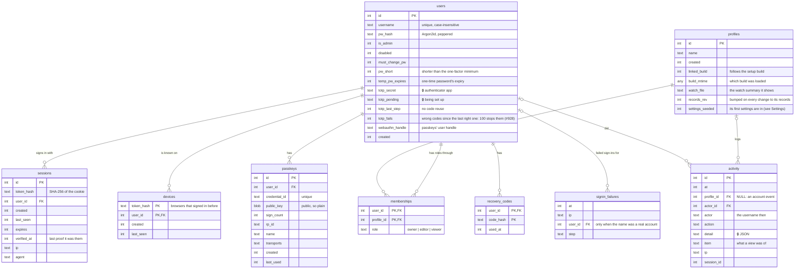
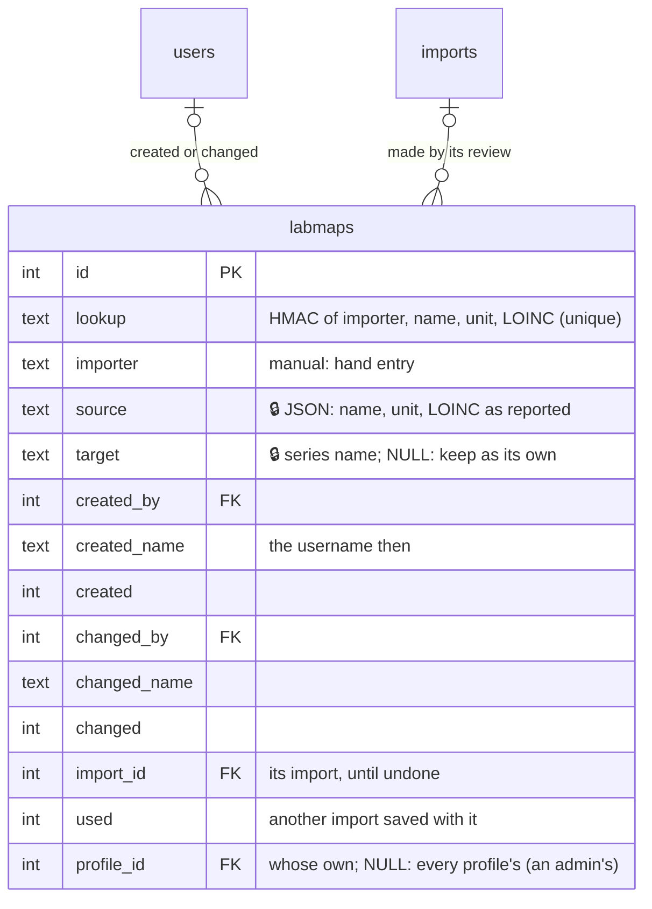
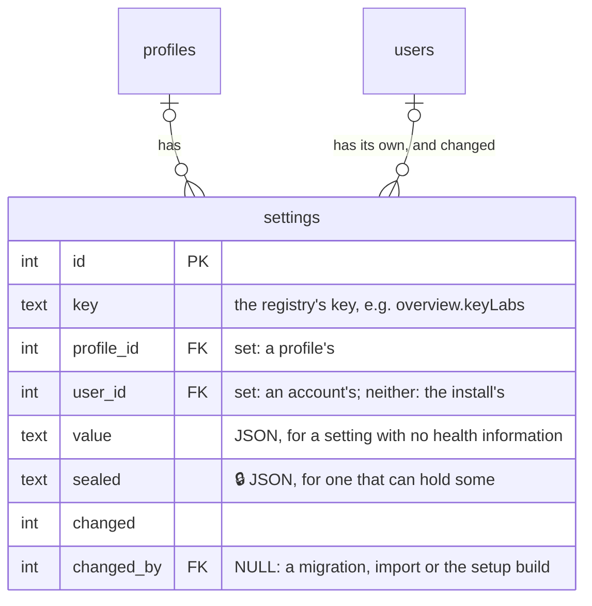
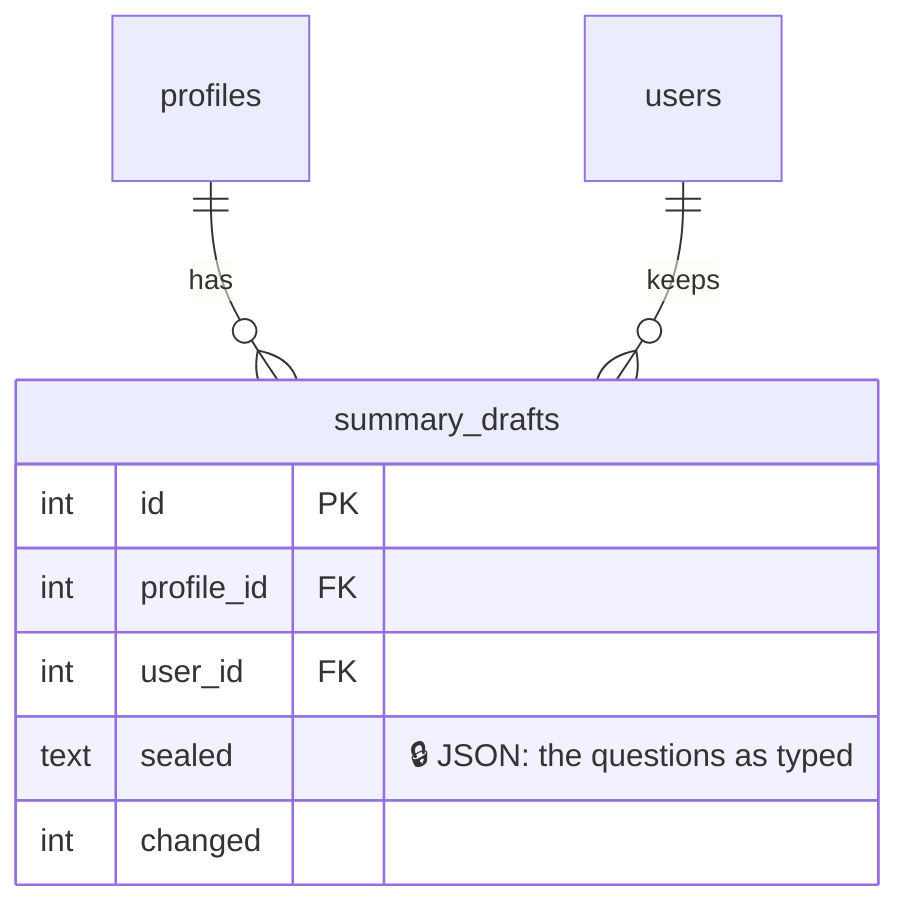
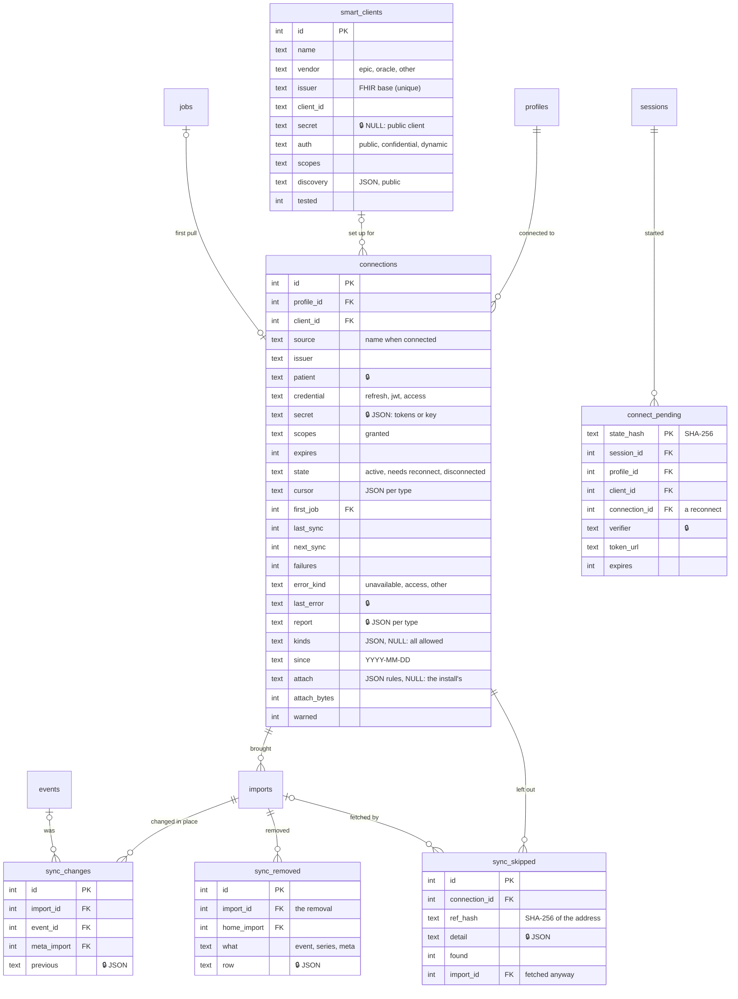
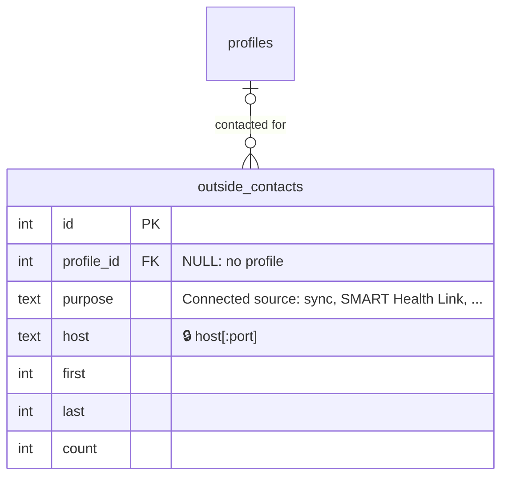
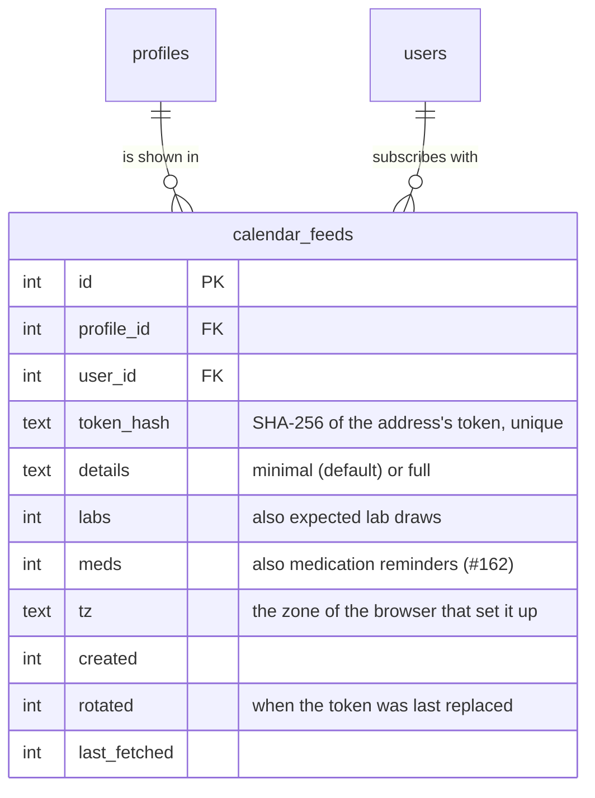
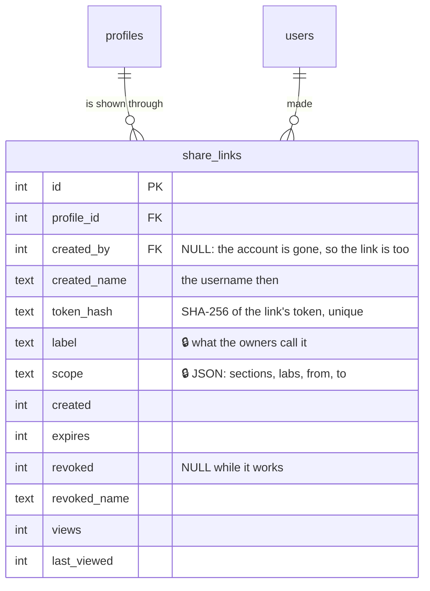
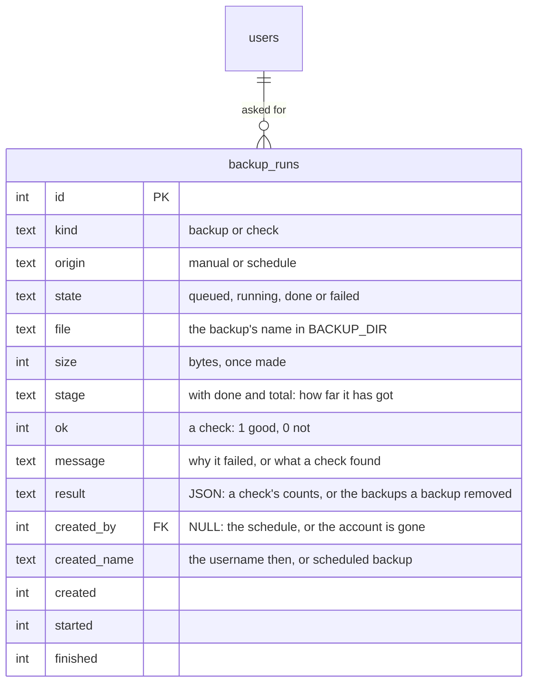

# Database design

Sanguity keeps everything in one SQLite database, `DATA_DIR/sanguity.db`, plus files in the data folder that it
points at (documents, uploads, previews, watch summaries). The schema is built step by step from `SCHEMA` in
[`server/db.py`](../server/db.py): each step is a numbered version (`PRAGMA user_version`), applied once at start-up,
so an older install upgrades itself. This page describes **schema version 43**. When you add a step, update the
diagrams here too.

Two things hold everywhere:

- **Health information is encrypted.** Every column that holds records, document names or secrets is encrypted with
  the data key (`crypto.enc`, AES-256-GCM), marked 🔒 below. Only ids, links between rows, timestamps, states and
  counts are plain. Where a value must be found without decrypting every row, a keyed hash (HMAC) of it is stored
  beside it (`key_hash`, `target`).
- **Everything belongs to a profile, and goes with it.** Deleting a profile removes its records, imports, uploads,
  jobs, edits, same-result links, journal entries, settings, memberships and activity by `ON DELETE CASCADE`. Records also belong to the import that brought them
  in, so undoing an import removes exactly its rows.

## Accounts and access

People sign in as **users**. A **profile** is a person whose health is tracked. **Memberships** link the two with a
role (owner, editor or viewer), so one account can look after several profiles and one profile can be shared.



`meta` (`k`, `v`) holds install-wide values: the pepper for password hashes (encrypted), the setup code's hash, and
one-off migration markers. Schema version 40 (#899) adds one, `labitem_keys`: the lab events a connected source saved
before #885 have no `keys` (each row's own record), which the rows and results don't say and which are encrypted, so
`sync.backfill_keys` gives them theirs at start-up from the connection's store of what it has read, then clears it;
a pull gives those of the days it reads theirs as it goes (`sync._give_keys`, #909).

## Records and imports

Records come in as **imports**: the setup build, an export loaded with `server.manage import`, an upload from the
browser, or results typed in. A browser upload is stored as raw files (**uploads**, **upload_files**), read by a
background **job** that stops at a preview, and saved as one import once confirmed; one no job reads (a file sent for a
record typed in that was never saved) goes a day on, unless it's an export's put back by `server.manage import`
(`put_back`, schema version 43, #944). An import's **events** (visits,
stays, lab draws, documents, claims…), lab **series** and their **results**, and its **documents** all point back to
it. **Edits** (corrections) belong to the profile instead, keyed by a hash of each event's source key, so they
survive re-imports and undo. So do **same_results**: the person's decision that a lab result from one source is the
same as one from another (shown once, with both sources) or not (no longer flagged), found by both results' point
keys (`server/crossmatch.py`, #96). Records typed in have no job, so the import itself names the account that typed
them in (`created_by`, schema version 35, #325), for the import history; it's NULL for every other origin. An
import's id is never used again (`AUTOINCREMENT`, schema version 37, #512): undone, it keeps its id in **import_undos**,
and the page still finds it by that id (Import history, a toast's Undo), so the next import gets a new one. The steps
run with foreign keys off, as SQLite says to make a table again that others point at, and each is checked before it
commits (`db.upgrade`).

No id that a page, a file or another table holds is given again either (`AUTOINCREMENT`, schema version 39, #588):
accounts, profiles, sessions, passkeys, uploads, jobs, events, series, edits, lab-name matches, connected sources and
connections, their left-out attachments, same-result links, calendar feeds, journal entries and their photos, share
links, medication reminders and doses. Without it the newest row's id, once deleted, went to the next row made: a
page loaded before an undo hid or renamed the record the next import brought, a stale page's save or delete changed
another journal entry, dose, reminder or edit, and the next sign-in after one signed out had its views taken as
logged already (`activity.once` also matches the account now). Version 39 made those tables again as version 37 made
imports, each count starting after the highest id it has had (a signed-out session the activity log names included).
A profile's id is its watch receiver slot, so a deleted profile's phone data showed in the next profile given its
id: the receiver is now asked to delete the slot (`watch_keys.forget`, `"deleted"` in the receiver's secrets file),
and a new profile's id also skips any a slot or folder left on disk is named by (`profiles.create_profile`).
survive re-imports and undo. So do **journal** entries (#49, `server/journal.py`): notes, symptoms and side effects
the people using the profile write themselves. They aren't records from anywhere, so no import owns them; the
records the page loads list them as `journal`, and an export carries them in its `data.json`. Since #161 an entry
can also be a day's mood and energy, say where on the body (region ids of the outline the page draws), name the symptom
group it was logged with (the groups themselves are the sealed profile setting `journal.groups`), and list photos:
**journal_photos** (schema version 32, `server/journal_photos.py`) has one row a photo, pointing at its entry (NULL
while the entry isn't saved yet), with only its random file name in `profiles/<id>/journal/`, its type and size; the
picture is sealed there with its metadata (GPS location, camera, time taken) taken out, and what it shows is in the
entry's encrypted body. Deleting the entry deletes its photos; an export carries them in `journal/photos/`. Since #1139 a
photo can be of a named spot (a mole, a rash, a wound, looked at over time): **journal_spots** (schema version 50) has
the profile's spots, each name encrypted, and `journal_photos.spot_id` says which one a photo is of; a spot no photo is
of goes, and an export carries each photo's spot by name. **insurance_plans** (schema version 55, #1137,
`server/insurance.py`) are a profile's health plans: the body (plan name, member ID, group number, phone numbers) is
encrypted, and each side's card photo is a sealed file in `profiles/<id>/insurance/` under a random name, cleaned as a
journal photo is; an export carries them as `insurance` in `data.json` and `insurance/<id>-<side>.<ext>`. The medication
timeline (#50, `server/medications.py`) is worked out from the `med` and `rx` events each time the records are put
together and listed as `medications`; it has no table and is never stored from an import. **med_reminders** (schema
version 33, #162, `server/med_reminders.py`) are the lines of a medication's schedule (#1094; version 47 made each
reminder one): like journal entries they belong to the profile and find their medication by its grouping key, so undo
keeps them; the body (the medication, times with the amount at each, days, from, until, time zone, As needed) is
encrypted, `remind` (`active` before version 47) says whether its Remind me puts it in the calendar feed. **med_doses** (the same
step, #235, `server/med_log.py`) is the medication log: doses logged as taken, taken late or skipped, the profile's
like the journal; the body (the medication, when, what happened, a note, the scheduled time and the amount, #1095) is encrypted, and the
records list them as `doses`. A phone's doses are watch data (`med_doses` in the receiver's summary), not rows here.
**med_entries** (schema version 46, #1091, `server/medications.py`) are a profile's own medications and its changes to
those of the records: an own one has a key of its own ("own:" and a random word), a change finds its medication by the
grouping key, as reminders do, keeping only what differs from the records, or that it's hidden (#1093); the body is
encrypted, and the records list them in `medications` (and the hidden ones as `hiddenMeds`). **family_entries**
(schema version 53, #1134, `server/family.py`) are a profile's own family history entries (a relative and their
conditions, its key "own:" and a random word) and its hiding of entries of the records' (by source key, so a later pull
doesn't bring one back); the body is encrypted, and the records list them in `familyHistory` (the hidden ones as
`hiddenFamily`). **followups** (schema version 56, #1138, `server/followups.py`) are the person's own follow-ups from a
visit: the body (its words, date, the record it's about, whether it's done and whether the calendar feed shows its
words) is encrypted, and the records list them as `followups`. **records_requests** (schema version 57, #1133,
`server/rec_requests.py`) are the person's requests for their own records: the body (who it went to, when and how, the
rule its response date is counted by, the records and format wanted, its status) is encrypted, `import_id` is the import
its records came in (NULL again when that import is undone), and the records list them as `requests`, their dates
worked out. An import's
**name** (schema version 25, #38) is what the person renamed it to, encrypted; the records call it by that wherever
they say where a record came from, and NULL means the importer's label. **cost_marks** (schema version 27, #55,
`server/oop.py`) hold what a person said about an out-of-pocket amount on the Costs tab: a payment or a claim's share
tagged HSA or FSA, a payment matched to a claim (or to none), two look-alike payments said to be two. Like edits they
belong to the profile and find their payment or claim by a keyed hash of its key. (Versions 26 and 27 belong to work
landing alongside.) **notify_topics** (schema version 54, #1130, `server/notify.py`) is each person's own topic on the
install's notification server (random, encrypted); **notify_optins** are each person's notifications turned on, per
profile they can see and per kind (`results`, `doses`); **notify_sent** is each notification made, once per person,
keyed by what it's for (an import, or a profile's dose time on a day) and whose, with its state, tries and next try.
None holds a message: what's sent is made as it's sent, from the kind and the profile's name alone.

```mermaid
erDiagram
    profiles ||--o{ imports : "has"
    imports ||--o{ events : "brought"
    imports ||--o{ series : "brought"
    series ||--o{ results : "holds"
    imports |o--o{ documents : "links"
    profiles ||--o{ uploads : "has"
    uploads ||--o{ upload_files : "holds"
    uploads ||--o{ jobs : "is imported by"
    jobs |o--o| imports : "saved as"
    profiles ||--o{ import_undos : "remembers"
    profiles ||--o{ edits : "has"
    events }o..o{ edits : "matched by key hash"
    profiles ||--o{ same_results : "has"
    results }o..o{ same_results : "matched by point key"
    profiles ||--o{ journal : "has"
    journal ||--o{ journal_photos : "shows"
    profiles ||--o{ journal_spots : "has"
    journal_spots ||--o{ journal_photos : "of"
    profiles ||--o{ med_reminders : "has"
    profiles ||--o{ med_doses : "has"
    profiles ||--o{ med_entries : "has"
    profiles ||--o{ family_entries : "has"
    profiles ||--o{ followups : "has"
    profiles ||--o{ records_requests : "has"
    imports |o--o{ records_requests : "brought"
    profiles ||--o{ cost_marks : "has"

    profiles {
        int id PK
        int records_rev
    }
    imports {
        int id PK "never used again (#512)"
        int profile_id FK
        int at
        text origin "build | dataset | upload | manual"
        text format "the importer that read it"
        int synced "last sync of a live connection (#91), else NULL"
        text meta "🔒 JSON: source, built, problems, upcoming visits, payments..."
        text name "🔒 what the person calls it (#38), else NULL"
        int created_by FK "the account that typed it in (#325), else NULL"
    }
    events {
        int id PK "the id the page sees"
        int profile_id FK
        int import_id FK
        text body "🔒 JSON: time, kind, title, source key..."
        text detail "🔒 JSON: what the drawer shows"
        text cost "🔒 JSON: its Costs row"
        int cost_seq "order on the Costs tab"
        text key_hash "HMAC of the source key"
    }
    series {
        int id PK
        int profile_id FK
        int import_id FK
        text body "🔒 JSON: name, unit, panel, LOINC"
        text key_hash "HMAC of the source key"
    }
    results {
        int id PK
        int profile_id FK
        int import_id FK
        int series_id FK
        text body "🔒 JSON: time, value, range, flag"
    }
    documents {
        text id PK "random, can't be guessed"
        int profile_id FK
        int import_id FK
        text path "🔒 file it serves"
        text ext
    }
    uploads {
        int id PK
        int profile_id FK
        int created_by FK
        int created
        text state "receiving | ready | discarded"
        int put_back "an export's, put back: kept though no job reads it (#944)"
        int files
        int bytes
        text manifest "🔒 JSON: stored name, path, size"
    }
    upload_files {
        int upload_id PK, FK
        text name PK
        text file "random name on disk"
        text path "🔒 path in the upload"
        int bytes
    }
    jobs {
        int id PK
        int profile_id FK
        int upload_id FK
        int created_by FK
        int confirmed_by FK
        text state "queued | running | preview | done | failed | discarded"
        text stage "detecting | parsing | saving"
        text importer
        text message "🔒"
        text warnings "🔒 JSON"
        text summary "🔒 JSON: counts, duplicates, range"
        text keep "duplicates saved anyway"
        text labs "🔒 JSON: lab-name matches chosen at the preview"
        text same "possible matches confirmed as the same result"
        int import_id FK
        int created
        int started
        int finished
    }
    import_undos {
        int id PK
        int profile_id FK
        int import_id "gone, so not a reference; no other import has it"
        int at
        int by_id FK
        text by_name
        text entry "🔒 JSON: what the history showed"
    }
    edits {
        int id PK
        int profile_id FK
        text target "HMAC of the event's key"
        text target_key "🔒 the key"
        text action "hide | rename | date | not_stay | merge | kind | kind_rule"
        text other "merge: the other event's HMAC"
        text other_key "🔒"
        text value "🔒 JSON"
        int created_by FK
        int at
    }
    same_results {
        int id PK
        int profile_id FK
        text pair "HMAC of both point keys"
        text a_key "🔒 one result's point key"
        text b_key "🔒 the other's"
        int same "1 same result, 0 not the same"
        text value "🔒 JSON: both sides when decided"
        int created_by FK
        int at
    journal {
        int id PK
        int profile_id FK
        text body "🔒 JSON: kind (note | symptom | side_effect | mood), date, what, severity 0-10, note, medication, where, group, photos (id, what it shows), mood, energy"
        int created_by FK
        text created_name "the username then"
        int created
        int changed_by FK
        text changed_name
        int changed
    }
    journal_photos {
        int id PK
        int profile_id FK
        int entry_id FK "NULL until its entry is saved"
        text file "random name of the sealed picture in profiles/<id>/journal/"
        text type "jpeg | png | webp"
        int bytes
        int created
        int created_by FK
        int spot_id FK "the spot it's of, or NULL"
    }
    journal_spots {
        int id PK
        int profile_id FK
        text name "encrypted"
        int created
        int created_by FK
    }
    med_reminders {
        int id PK
        int profile_id FK
        text body "🔒 JSON: medication key and name, times and amounts, days, from, until, time zone, as needed"
        int remind "Remind me: 1 in the calendar feed, 0 not"
        int created_by FK
        text created_name "the username then"
        int created
        int changed_by FK
        text changed_name
        int changed
    }
    med_doses {
        int id PK
        int profile_id FK
        text body "🔒 JSON: medication key and name, time, taken | late | skipped, note, scheduled time, amount and unit"
        int created_by FK
        text created_name "the username then"
        int created
        int changed_by FK
        text changed_name
        int changed
    }
    med_entries {
        int id PK
        int profile_id FK
        text body "🔒 JSON: key, own, name, strength, dose, route, start, stop, status, prescriber, note, hidden"
        int created_by FK
        text created_name "the username then"
        int created
        int changed_by FK
        text changed_name
        int changed
    }
    family_entries {
        int id PK
        int profile_id FK
        text body "🔒 JSON: key, own, relation, name, conditions, deceased, deathAge, note; or key, hidden"
        int created_by FK
        text created_name "the username then"
        int created
        int changed_by FK
        text changed_name
        int changed
    }
    cost_marks {
        int id PK
        int profile_id FK
        text target "HMAC of the payment's or claim's key"
        text target_key "🔒 the key"
        text value "🔒 JSON: hsa, claim, same"
        int created_by FK
        int at
    }
```

A **point key** is what identifies a lab result across re-imports, as the preview identifies one: the series' source
key (or, without one, its name), the unit, the time and the value as reported. `pair` is
`HMAC(pepper, "sanguity same result\0" + both keys, sorted)`, so a pair is found, and the page refers to it, without
decrypting anything; it is unique per profile, and a second decision on a pair replaces the first. When the records
are put together, a "same result" whose two results are both there shows once (the older import's), with the other's
source listed; when either import is undone the decision stays, unapplied, until it comes back.

## Lab-name matches (a profile's own, or an admin's for every profile)

When an import's preview finds a lab name that `lab-aliases.json` doesn't know, the person importing matches it to
an existing series the review offers, or a test that list knows, or keeps it as its own (`server/labmap.py`). The
choice is remembered in **labmaps** as that profile's own (`profile_id`, schema version 41, #927) and applied to that
profile's later imports, pulls and results typed in only; a match an admin made before is for every profile
(`profile_id` NULL), and a profile's own is used before it. Rows are looked up by a keyed hash of the importer, the
name as reported, its unit and LOINC code, and the profile for a profile's own; the name and the series it goes to are
encrypted. Only admins can change or remove one, but for undoing the import whose review made it (`import_id`, schema
version 36, #500): that forgets it, unless another import has been saved with it since (`used`) or an admin has
changed it. Deleting a profile forgets its own (#591, #927). At the upgrade to version 41 a review's match became its
import's profile's (keyed with it at the next start), an admin's stayed for every profile, and one whose import was
gone was left for every profile but to check, unless #546's rule would make it.



## Settings (per profile, per user or per install)

What used to be a `settings.json` per profile (key labs, lab nicknames, workout rules...) is one row per setting in
**settings** (`server/settings.py`, #35). The registry there says, for each setting, whether its value belongs to a
profile (`profile_id` set), to an account (`user_id` set, the same on every profile) or to the whole install
(neither), and who changes it: a profile's owners and editors, the person themself, or admins. The page reads the
merged value: the default, then the install's row, then the profile's, then the user's. A value that can hold health
information (lab names, rules) is encrypted in `sealed`; any other is plain JSON in `value`. `profiles.settings_seeded`
marks a profile whose settings were seeded (from its own `settings.json` at the upgrade, or the setup build's the first
time the build is loaded into it), so a later rebuild never fills one in again.



One row per key and owner (a unique index on `key`, `IFNULL(profile_id, 0)`, `IFNULL(user_id, 0)`).

An install row can be a server setting the environment can set too (#999): its registry entry names the variable
(`env`, one of `server/config.py`'s `VARS`), and the row is plain. The server reads it through `config.setting(NAME)`
wherever it's used: the environment's value when the variable is set (not empty), else this row, else the default.
Such a row is read over a read-only connection of its own, at most every two seconds, and at once after a change.

The `units` setting (#41) is a user's row, plain JSON (`{"lab", "weight", "temperature", "height"}`). The conversions it picks
from aren't stored: each lab series the page loads carries its exact ones (`conv`, from `server/units.py`) when the
records are put together, and the page converts as it draws, keeping what was reported.

Reference ranges from settings (#44, `server/ranges.py`) are an ordinary profile setting, sealed: `ranges.overrides`
(a list of `{lab, unit, sex: "any"|"female"|"male", ageFrom, ageTo, low, high}`, ages in whole years and inclusive,
either end open), applied when the page or the visit summary reads the records, never written into them. The birth
date and sex they are matched against are About this person's.

About this person (#194, `server/person.py`) is six profile settings, sealed, not among the Settings screen's sections
(Settings → About this person changes them, `www/js/about.js`; on Sharing before #267): `person.birthDate` ("" or
YYYY-MM-DD), `person.sex` ("", "female" or "male": the sex labs base reference ranges on) and `person.heights` (a list of `{date, cm, unit}`, oldest first, one per day: the
height in centimetres to two decimals, and `unit` "cm" or "ftin", how it was typed); and, since #197, `person.maxHr`
(a measured maximum heart rate in whole bpm, 0 when not set, for heart rate zones); and, since #196, `person.dueDate`
("" or YYYY-MM-DD: for a baby born early, the day they were due, after the birth date and at most 20 weeks after it;
growth charts use it for the corrected age before 2 years; no schema step, a setting like the others); and, since #234,
`person.targets` (targets of the person's own for home readings, as their care team gave them, `server/targets.py`:
`{measure: target}` for "bp" (`sysLow`, `sysHigh`, `diaLow`, `diaHigh` in mmHg), "glucose" and "cgm" (`low`, `high` in
mg/dL), "temp" (°C), "spo2" (%), "weight" (kg) and, since #298, "steps" (steps a day), each bound optional but not both, with `unit` as typed, `by` (who set
it) and `on` ("" or YYYY-MM-DD); no schema step). For time in that CGM range, the watch summary's `glucose_dist` metric
counts each CGM day's readings by whole mg/dL (`[lowest, count at it, at the next, ...]`, `server/glucose.py`), sealed
with the rest of the summary; `GET …/watch` turns it into the day's shares (`glucose_own_lt/in/gt`) and never sends it. **Schema version 30** moved #44's
`ranges.birthDate` and `ranges.sex` to `person.birthDate` and `person.sex` for every profile, once, by renaming the rows
(the sealed values are unchanged); a `settings.json` from before (an export, the setup build's) is read with the old
names as the new ones.

Edits (#33) gained two actions in **schema version 34** (#237), which made the table again with a wider `CHECK` and
copied every row: `kind` moves an entry to another category, and `kind_rule` keeps doing it for a source's new
imports; a rule's `target` is the HMAC of `"rule:"` and a hash of the source, kind and title, not of an event's key.
Edits made at once to similar entries share a `batch` id in their sealed `value`, and are undone together. Since #937 an
edit of a lab event or a lab day also keeps, in its `value`, what it held (`holds`, and a merge's `other_holds`: its
rows' records, else their tests), as every import's lab event of a day shares the day's key; it finds only the one
holding them. An edit from before keeps finding every event with its key.

Until schema version 31 one key outside the registry lived here too: `summary.questions`, a profile's draft of
questions for the visit summary (#48), shared by everyone the profile was shared with. Each person now keeps their own,
in [`summary_drafts`](#visit-summary-drafts).

## Visit summary drafts

The questions a person types for the visit summary (`server/summary.py`, #48) are kept as their own draft, one per
account and profile (#219), so one person's questions never replace another's. `sealed` is the text, encrypted. A
draft goes with the account, the profile, or the account's access to the profile (the trigger
`summary_drafts_unshared` removes it when the membership goes). It isn't a setting: never on the Settings screen or in
an export. **Schema version 31** created the table and moved each profile's shared draft once: to the account that kept
it last, and, unless that account was a viewer, to every owner and editor of the profile too (they saw it before); a
viewer never gets someone else's.



## Connected sources

A profile can be connected to a provider's or insurer's FHIR API by signing in to it (#32), and is then kept up to
date on a schedule (#91; `server/connections.py`, `server/smart.py`, `server/sync.py`). How sign-in works is decided
in [connected-sources-oauth.md](connected-sources-oauth.md): each install registers its own app with each vendor.

- **smart_clients** is what an admin set up per source (install-wide): the FHIR base (issuer), the client ID, the
  client secret where the vendor issued one, how the app authenticates and the scopes to ask for, and the discovery
  its last test read. The server contacts no host for that source other than the issuer's and those its discovery
  names for the token, revocation and registration endpoints. Its FHIR base can't change while a profile is
  connected to it (#926): a connection's tokens belong to the server at the address it was made with.
- **connections**: one per profile and source. The access token, the refresh token or (with Epic's dynamic
  registration) the private key and dynamic client ID are one encrypted JSON value, deleted on disconnect, as is the
  patient id. `cursor` is the `_lastUpdated` to ask after, per resource type; `state` is `active`, `needs reconnect`
  (the vendor ended access) or `disconnected` (kept, without credentials, so the count and the history can name it).
- **connect_pending**: a sign-in between leaving for the vendor and coming back, at most 10 minutes. Only a hash of
  `state` is stored; the PKCE verifier is encrypted; it is bound to the session that started it and used up on
  return, whatever the outcome.
- **imports.connection_id**: the connection an import came from (the first pull, then each sync, origin `sync`).
- **sync_changes**: what a sync changed in place (an event, or an entry of an import's profile-wide lists), with what
  it was before, so undoing that sync puts it back. A later sync that changed the same record again inherits the
  "before". Since #869 an upload's import has them too, and an event's "before" may list results (`"results": [[result
  id, its body before]]`): results here that their source sent again, amended (a re-pull or a re-sent FHIR
  Observation's corrected range), updated in place with their drawer rows (server/preview.py update()), never copied;
  undone with the import. Since #920 so are an upload's records of any other kind that their source sends again
  saying something else (preview.change(): a medication stopped, a problem resolved, a claim processed). A listing or
  fill sent again under another name takes its medication's reminders, doses and side effects along (#960,
  medications.follow), and its "before" says what moved (`"moved"`, as a rename's edit keeps it, #954), put back with
  the import's undo.
- **smart_clients.waiting** (schema version 29, #165): when an admin marked the source as waiting for the vendor's
  review, NULL otherwise. While it is set nobody can connect the source, its client ID may still be empty, and
  Portals and health plans tells people to upload the portal's export meanwhile.

Beside the rows, each connection keeps every FHIR resource it has read, the newest version of each, sealed in
`profiles/<id>/connections/<connection id>` (a lab day is rebuilt from all of them); it is deleted on disconnect.
Each pull's raw answer is kept as an upload, like an import's files.

Schema version 21 adds what a connection pulls and how it warns (#99, #101, #102):

- **connections.kinds** and **since**: the person's choice of records (`connections.KINDS`: labs, vitals, visits,
  problems, medications, documents, claims) and the date to pull from; NULL is everything the access allows, from
  the beginning. **connect_pending** keeps the same two from the start of a sign-in to its return. The cursor's
  keys name each search with its parameters (`Observation?category=laboratory&date=ge2021-01-01`), so a kind turned
  on later is pulled from the beginning; a connection from before version 21 keeps its plain type names.
- **connections.attach**: the connection's own attachment rules (`{auto, max_mb, types, budget_mb}`), over the
  install's settings `sync.*` in **settings**; **attach_bytes**, what it has fetched, for its total.
- **connections.warned**: when the "stopped syncing" warning went into the profile's activity log, so it goes in
  once; cleared when a pull works or the connection is signed in again.
- **sync_skipped**: attachments a pull left out (by its rules), one row per attachment address (a SHA-256 of it);
  the address, its record's source key, title, kind, size and why are encrypted. `import_id` is set once it is
  fetched anyway, by that import, and goes back to NULL (listed again) when that import is undone.
- **sync_removed**: the rows "remove the records of a kind" took out (events, a series with its results, or the
  entries of an import's profile-wide list), encrypted, under the import that removed them. Undoing that import from
  the history puts them back in their own imports, with their ids where those are free (a result's too). An event's
  row keeps its `sync_changes` (what pulls kept of it for Undo, which go with it) and, for a lab event, the lab days it
  was taken out of as they were (#914), so it goes back in them, or in one made again.
- **imports.note**: what a sync import that isn't a pull did (removed a kind, or fetched an attachment), encrypted,
  for the history's label and counts.



## Outside contacts

Every request Sanguity's server makes to another host goes through `server/net.py` under a permit from
`server/outside.py` (#97, #59): a connected source's hosts (as its admin-tested discovery names them), or the host of
a SMART Health Link someone confirmed. Each contact is recorded before anything is sent: in the activity log, and in
**outside_contacts** (schema 20), one row per profile, purpose and host with the first and last contact and a count,
for the outside-connections view in Settings → Install. Only the host is kept, encrypted (a Health Link's host can say
where someone is treated); never a path, query, token or key. `profile_id` is `NULL` for a contact with no profile
involved (an admin's "Test this connection"); a profile's rows go with it.



## Calendar feeds

A **calendar feed** (`server/calendar.py`, #51) is the private address a person's own calendar app fetches to show the
profile's upcoming appointments and expected lab draws. There is one per person and profile. The address carries a
random token, and only its SHA-256 is kept in `token_hash`, as for sessions. A feed works only while its person can
still view the profile: the membership and the account are checked at every fetch, and the row is deleted once they
can't, and on Sign out all other devices, an admin's reset and a recovery-code sign-in (#590). Fetches aren't logged, only the
time of the last one; making, rotating and revoking a feed are logged in the profile's activity (`calendar`).



One row per profile and user (unique).

## Share links

A **share link** (`server/share_links.py`, #47) lets someone without an account read part of a profile: the
sections, labs and date range an owner chose, read-only, until it expires (at most 90 days) or an owner revokes it.
As for sessions and calendar feeds, only the SHA-256 of the link's token is kept, in `token_hash`. A link works only
while the owner who made it is still an owner with an account that isn't disabled; if that account is removed,
`created_by` becomes `NULL` and the link stops. Once its maker isn't an owner, the link is revoked for good (#590):
`revoked` is set with `revoked_name` left `NULL` (no one revoked it), listed as stopped with its maker. Every view is counted here and logged in the profile's activity
(`link`, actor "share link", with the viewer's address). Revoked and expired links stay listed for 30 days, then
are deleted.



## Backups (install-wide)

The backups themselves are files in `BACKUP_DIR` (`server/backup.py`); `backup_runs` (schema version 28, #200) is
what Settings → **Backups** asked for and how it went: **Back up now**, the schedule's backups (origin
`schedule`, made by "scheduled backup") and **Check a backup**, one row each. `server/backup_jobs.py` runs them in
turn in the background (`queued` → `running` → `done` or `failed`), and the page polls the one running. A check
that ran and found the backup damaged is `done` with `ok` 0 and what it found in `message`. A backup's file is named
before the database is copied, so a database restored from that backup knows its own row; at start-up, rows left
running are marked done if their file was finished, failed otherwise. The newest 100 rows are kept. Nothing here is
health information (file names, sizes, row counts), so nothing is encrypted. The schedule and how many backups to
keep are in `meta` (`backup.schedule`, `backup.keep`). A backup also holds the watch receiver's data (#227, see
[the watch receiver's own database](#the-watch-receivers-own-database)); a check's `result` then has its counts too,
cycle records compared but not named (only a profile's owners and editors may know they're kept).

**What a restore keeps (#917).** A restore brings back records only: the backup's database is brought up to date in
the folder below, and given today's `users` (by id and name, so records keep who made them; every column of the
row today's, the wrong authenticator codes since the last right one, `totp_fails`, #928, among them), `devices`,
`recovery_codes`, `passkeys`, `signin_failures`, `memberships`, `share_links`, `calendar_feeds`, each profile's phone
upload secret (the `_watch.receiver` settings row) and its cycle tracking (the `_cycle` row, #964: none where today's
has none), and the `require_2fa`, `setup_code` and `watch_legacy_retired` meta
rows from the database it replaces, every `sqlite_sequence` count moved past today's (#588); `sessions` is emptied.
A profile whose cycle records the backup holds and today's tracking doesn't keep (off now, or a deletion asked for
since) is noted in the `cycle_restored` meta row, sealed, and its records deleted as turning tracking off deletes them
once the files are back (`cycle_tracking.restored`, again at the next start if a stop came between), the note with
them.
`smart_clients` is today's (by id and issuer, client secrets included), and so is each connection but its place in
what it pulled (`cursor`, `pending_cursor`, `first_job`, `last_sync`, `report`, `attach_bytes`, the backup's, so it
pulls again what came since); one today's database hasn't, or has disconnected, is disconnected, its tokens and store
gone; one connected since is added with nothing pulled. A phone upload secret taken away since, with its maker's
access (#929), stays away: there's no `_watch.receiver` row of today's to bring, and the receiver's secrets file is
written from the database when the app starts. The lab-name matches reviews made (`labmaps`, a profile's own since
#927) are records, not access: each is what an import of that profile chose and goes with that import's Undo, so
they're the backup's, each still its own profile's. A
profile the backup has that today's database hasn't comes back with no memberships, and the restore names it. With no
database to replace, one that can't be read (`quick_check` fails or it isn't a database: damaged, #958) or one whose
pepper isn't the backup's (another install's), all of it is the backup's, everyone signed out all the same, and the
restore says so (`backup._ready`). The receiver's data is staged only after that, once the restore will go ahead.

**What a restore replaced (#595).** A restore (`server.manage restore`, with the app stopped) moves the database,
`profiles/` and `build/` it replaces to `DATA_DIR/before-restore-<time>/` (`-1` added for a second restore in the same
second). That folder may hold a profile deleted before the restore, or since, so it is deleted `RESTORE_KEEP_DAYS`
(30) after the restore (the later of its name's time and its last change): at start-up and hourly while the app runs
(`backup_jobs.sweep_replaced`), or at once by an admin's **Delete now** on Settings → Backups, which lists them. A folder
is renamed `.deleting-…` before it's deleted, so a stop halfway leaves nothing that looks newer; what's left goes at
the next sweep. Only names a restore gives are touched, never a link. Each deletion is an account event
(`backup.replaced`, by "time limit" or the admin). A backup never includes it: it takes only the database, `profiles/`
and `build/`. So is the phone and watch data a restore leaves in `DATA_DIR/watch-restored-<time>/` when it can't write
the receiver's `keys/` folder, for the operator to move in by hand (#603): listed beside them, deleted as long after.



## The watch receiver's own database

The phone receiver (`watch/receiver.py`) keeps a database of its own per profile, `WATCH_DIR/watch.db` (or
`WATCH_DIR/profiles/<id>/watch.db`), apart from `sanguity.db`: held in memory and saved whole, sealed with the data key,
after uploads; `raw/` beside it keeps every upload, sealed too, and `--reprocess` builds the database again from it.
It has no numbered steps: each table is made if missing (`CREATE TABLE IF NOT EXISTS`) when the receiver starts, and
what a new table needs from earlier uploads is read from `raw/` once (marked in its `meta` table). The app reads the
daily summary it writes (`daily.json`), and, for backups (#227), the receiver's folder read-only (`config.WATCH_STORE`).

**In backups (#227).** Each `watch.db` is copied byte for byte, still sealed: the receiver replaces the file whole
(`os.replace`) when it saves, so the file is always one consistent snapshot and there's nothing to lock. Then every
upload in `raw/`, so those that came after the last save (its `meta` row `saved`) are there too. The manifest has, per
profile, every table's rows (sealed with the data key, #935: the plain manifest names no table), when it was saved
and how many uploads came after; **Check a backup** opens each copy
with the key, runs `integrity_check` and compares the rows. `public/` and `keys/` aren't copied: they're written again
from the database and from the app's. A restore leaves the copy in `keys/restore/` (with `restore.json`); the
receiver, at start, moves `watch.db`, `raw/`, `profiles/` and the files of `public/` (not the folder, which the app
has mounted) to `before-restore-<time>/` and the backup's in, then folds in the uploads after its last save.

**What it keeps, and how long (#593).** A slot's database, uploads, summary, ECG samples and `cycle.json` are kept
while a profile reads the slot or a secret uploads to it. A deleted profile's go when the app says so (`"deleted"` in
the secrets file, #588); an upload whose secret goes while it's being written is taken out again and refused, and one
already queued isn't folded in. A slot nothing names (no secret, and not in the file's `"slots"`, every slot a profile
reads: one a profile deleted before #588 left) is deleted `SLOT_GRACE_DAYS` (7) after the receiver first finds it so,
noted in `orphan-slots.json`; named again meanwhile, the wait starts again; a secrets file from an app without
`"slots"` takes nothing. A `before-restore-<time>/` folder is deleted `RESTORE_KEEP_DAYS` (30) after the restore. These
run at start, before anything is loaded, and hourly.

**Blood glucose (#181)** is `glucose(app, src, id, t, wall, v, kind)`: one row a reading, in mg/dL, from Health
Connect (`hc`, `id` its uuid) or Health Auto Export (`hae`, `id` its time), with its local time and, when the reading
says so, `cgm` or `meter` ([`server/glucose.py`](../server/glucose.py) has the rules). A continuous glucose monitor
sends 288 readings a day (one every five minutes); the receiver keeps them all, rather than only each day's summary,
because:

- the same reading arrives again and again (Health Auto Export's "Today" every hour, overlapping syncs), and only the
  readings themselves can be counted once; a day's summary can't be merged with part of the same day sent again;
- Health Connect deletes a reading by its uuid;
- the summary can be made again when how a day is summarised changes, without `--reprocess`.

What that costs, measured for a year of one sensor (`tests/test_glucose.py`): about **10 MB** in `watch.db` with
Health Connect's ids (7 MB from Health Auto Export), and about **3 MB** of gzipped uploads in `raw/`; the summary takes
0.1 s to make. The page gets the days only, about 70 KB a year in `daily.json`, and each day's hours for its
24-hour profile (#303: each hour's count of readings and their 5th to 95th percentiles), about 210 KB a year more,
made again from the readings with every summary (about a third more of its time). Both `watch.db` and `raw/` are in the app's
backups since #227 (above), so a CGM adds about 13 MB a year to each backup; the per-day summaries it hands the
app aren't stored in `sanguity.db`. If years of readings ever outgrow memory, readings older than a few months could
be folded into per-day rows (nothing older is sent again); that isn't needed yet.

**Menstrual cycle records (#183)** are `cycle(app, kind, id, src, day, end_day, v, v2)`: one row a record (flow,
a logged period, an ovulation test, cervical mucus, spotting), kept only for a profile whose owner turned cycle
tracking on (`"cycle"` in the secrets file the app writes); for any other the receiver takes them out of each upload
before it's archived, so they reach neither this table nor `raw/`. Sexual activity is taken out of every upload. The
records go to the app in `cycle.json` beside `daily.json` (sealed, never in `daily.json`), and `sanguity.db` holds
only the setting (a sealed `settings` row, `_cycle`). Turning tracking off, or "Delete all cycle data", asks the
receiver (a new `"cycle_purge"` token) to empty the table, vacuum the database and rewrite every upload in `raw/`
without them; `cycle.json` says which deletion was done. Turned off, the `_cycle` row goes once the receiver has
done that deletion (#935), so nothing in `sanguity.db` says tracking was ever on; the receiver then removes
`cycle.json` and its own note of the deletion, as the app no longer asks for it (#946). [`server/cycle.py`](../server/cycle.py) has the record types
and the rules.
**ECGs and irregular rhythm notifications (#182)** are `ecg(key, start, meta, wave)`: one row each, from Health Auto
Export, by its key (`ecg:` or `rhythm:` and a hash of its start in UTC, [`server/ecg.py`](../server/ecg.py)), so one
sent again replaces itself; `meta` is the event as the summary lists it (classification as the device wrote it,
average heart rate, device...) and `wave` a recording's samples, gzipped JSON in µV (a 30-second recording at 512 Hz
is 15,360 samples, about 50 KB). The summary lists the events without their samples; each recording's are written
beside it as a file of its own, `ecg/<16 hex>.json.gz`, sealed, which the app reads only when that recording's
drawer opens (`GET /api/profiles/{pid}/watch/ecg/{name}`). An ECG from an uploaded Apple Health export is kept the
same way in the profile's folder (`watch/ecg/`, `server/watch_store.py`), one file per recording whichever import
brought it, and removed once no import lists it. Health Auto Export sends a recording as about 1 MB of JSON, kept in
`raw/` like every upload.
**An uploaded Apple Health export's newer measures (#223)** land in the import's own summary in the receiver's shape:
the `bp_*`, `body_temp*` and `glucose_*` metrics, the `bp_readings` and `temp_readings` lists (summed up by the same
code, `apple_health.home_summary`), and `heights` ([day, cm, source, unit], offered on About this person, never a
metric). Laid over the receiver's summary (`watch_store.merge`), a reading in both (the same minute and values) is
listed once. Its cycle records, read only while cycle tracking is on, are never in a summary: they're kept sealed in
`<profile_dir>/watch/cycle/<import id>.json` (`server/cycle_tracking.py`).
**A workout's heart rate (#197)** is `exercise.hr`, a column added as an older store loads (its earlier uploads'
workouts read again from `raw/` once, marked `workout_hr` in `meta`): Health Auto Export's heart rate for the workout
as [`server/hrzones.py`](../server/hrzones.py) packs it, `{"avg", "max", "hist": [[bpm, seconds]]}`. Health Connect's
sessions carry none; their heart rate comes from `samples` in the session's time when the summary is written (an
index `samples_t` on type and time makes that quick). The summary gives each workout's `hr`; the app turns the
seconds at each bpm into minutes in each zone when the page asks, so only those reach the page. The measured maximum
heart rate is the profile setting `person.maxHr` (above), sealed like the other settings.

## What is encrypted

| Table | Encrypted columns |
|---|---|
| `events` | `body`, `detail`, `cost` |
| `series`, `results` | `body` |
| `imports` | `meta`, `note`, `name` |
| `documents` | `path` |
| `uploads` | `manifest` |
| `upload_files` | `path` |
| `jobs` | `message`, `warnings`, `summary`, `labs` |
| `import_undos` | `entry` |
| `edits` | `target_key`, `other_key`, `value` |
| `same_results` | `a_key`, `b_key`, `value` |
| `journal` | `body` |
| `journal_spots` | `name` |
| `med_reminders` | `body` |
| `med_doses` | `body` |
| `med_entries` | `body` |
| `family_entries` | `body` |
| `followups` | `body` |
| `records_requests` | `body` |
| `share_links` | `label`, `scope` |
| `cost_marks` | `target_key`, `value` |
| `labmaps` | `source`, `target` |
| `settings` | `sealed` |
| `summary_drafts` | `sealed` |
| `smart_clients` | `secret` |
| `connections` | `patient`, `secret`, `last_error`, `report` |
| `connect_pending` | `verifier` |
| `sync_changes` | `previous` |
| `sync_skipped` | `detail` |
| `sync_removed` | `row` |
| `activity` | `detail` |
| `outside_contacts` | `host` |
| `users` | `totp_secret`, `totp_pending` |
| `meta` | the pepper |

The list the start-up check and key rotation use is `FIELDS` in [`server/atrest.py`](../server/atrest.py); keep the
two in step. Every other text column is listed in `PLAIN` in `tests/test_security_refresh.py` with why it holds no
health information, so a new column fails that test until it is in one list or the other (#203). Files the rows point at (documents imported from an export, upload files, previews, imported watch
summaries, the journal's photos) are encrypted on disk too. Not encrypted: usernames and profile names (needed for sign-in and
sorting), and your original exports in `RECORDS_DIR`, which Sanguity only reads.

## What a deletion removes

| Deleted | Also removed (cascade) | Kept |
|---|---|---|
| A profile | memberships, imports with all their rows, documents, uploads and their files, jobs, edits, same-result links, journal entries and their photos, medication reminders and doses, cost marks, settings, visit summary drafts, calendar feeds, share links, undo history, its activity and outside contacts; and what the watch receiver keeps for its slot (its database, archived uploads, summary, ECG samples and `cycle.json`), which the receiver deletes when told (#588), unless another profile reads the same slot (a slot a profile deleted before that left, after a week, #593) | the original exports, backups made before, the app's and the receiver's `before-restore-<time>/` for 30 days (#593, #595) |
| An import (undo) | its events, series, results and documents; its upload's raw files unless another import uses them | edits, same-result links, journal entries, medication reminders and doses, and cost marks (they belong to the profile) |
| An upload | its files and jobs (a job's saved import stays) | the import it became |
| A connection (disconnect) | its tokens, key, patient id and stored resources; its imports too, if chosen; its hosts from "may contact" | the row, as disconnected; its outside contacts, listed as earlier ones |
| A profile's cycle records (#183: Delete all cycle data, or turning cycle tracking off) | the watch receiver's rows, and the records in every upload it archived (rewritten without them); `cycle.json` keeps only which deletion was done, until the app has seen it (then it goes, tracking off, #946); what imported Apple Health exports brought (`watch/cycle/`, #223), a waiting preview's, and the uploaded exports themselves, each `export.xml` written again without them (#555; one uploaded while tracking is off is kept without them, and never with sexual activity) | backups made before, exports and visit summaries already downloaded, the phone's own |
| An account | sessions, devices, passkeys, recovery codes, memberships, its own settings, its visit summary drafts, its calendar feeds, pending sign-ins | activity, uploads, jobs, journal entries, lab-name matches and share links it made (their links become `NULL`; such a share link stops working) |
