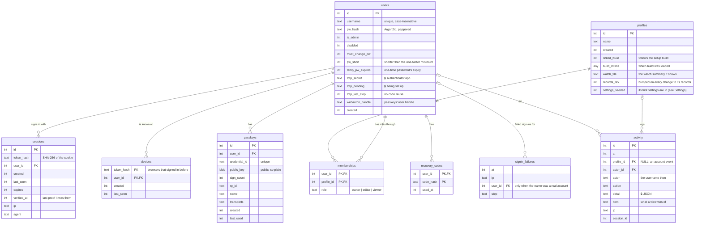
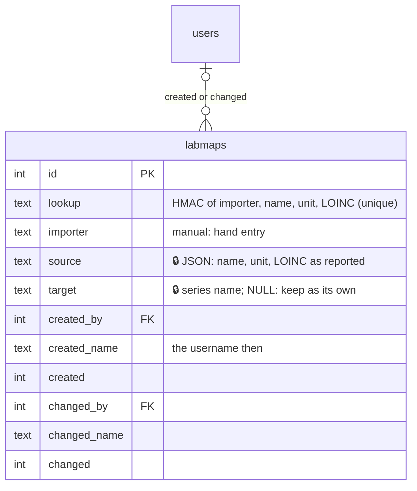
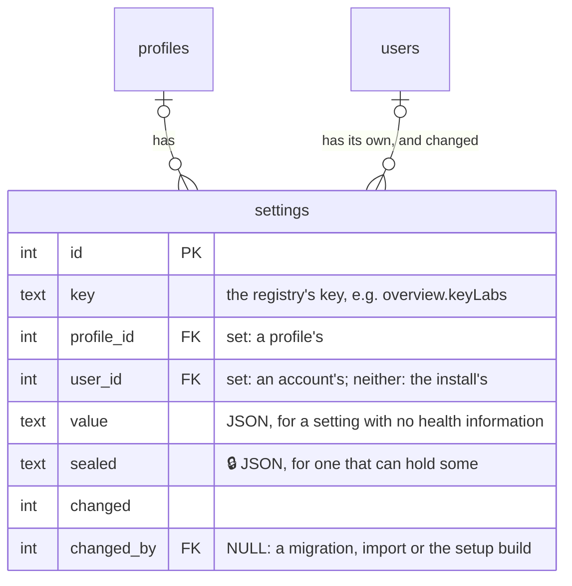
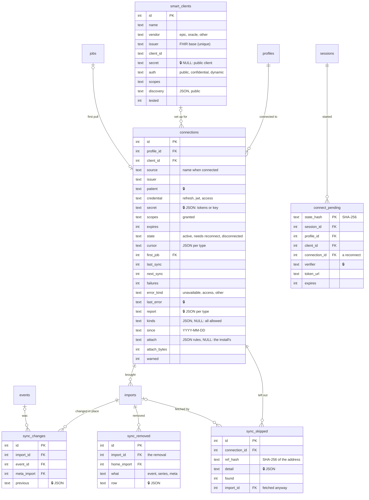
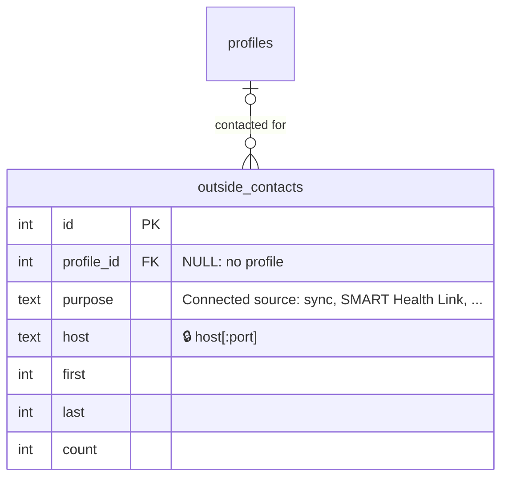
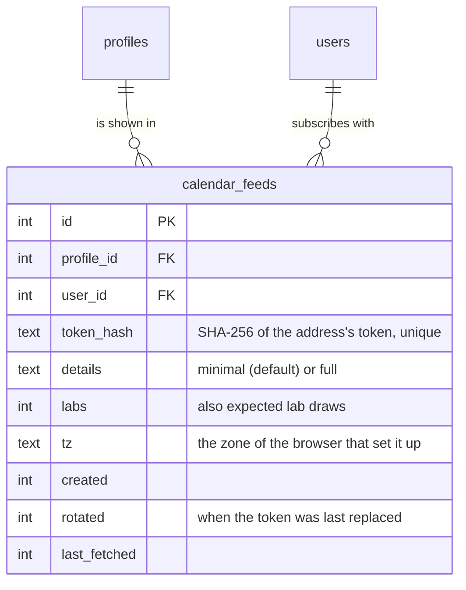
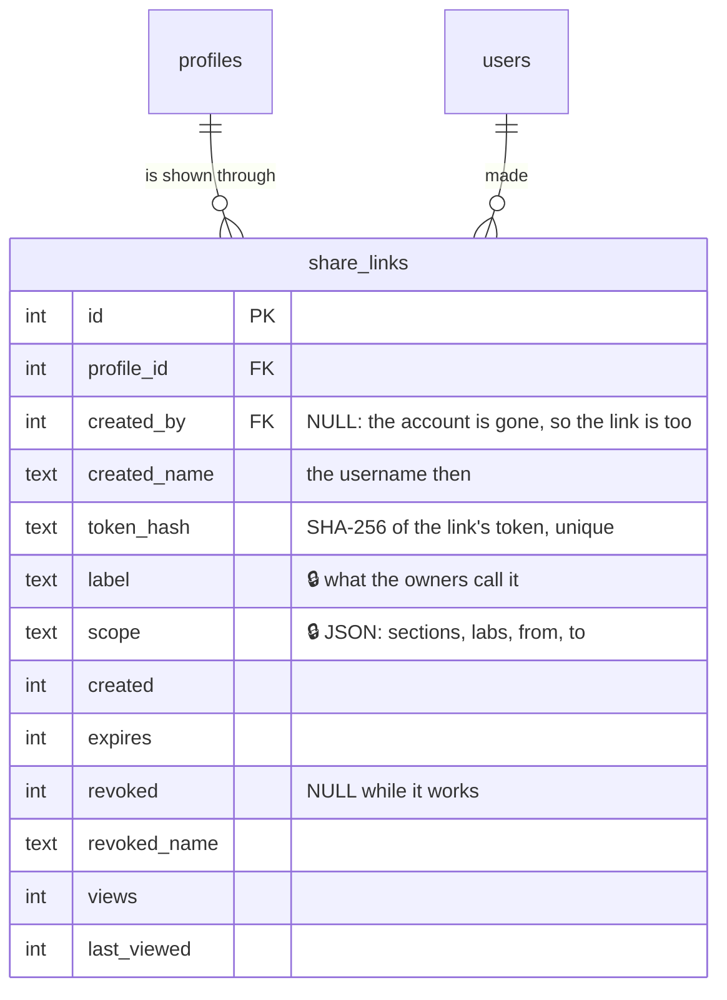
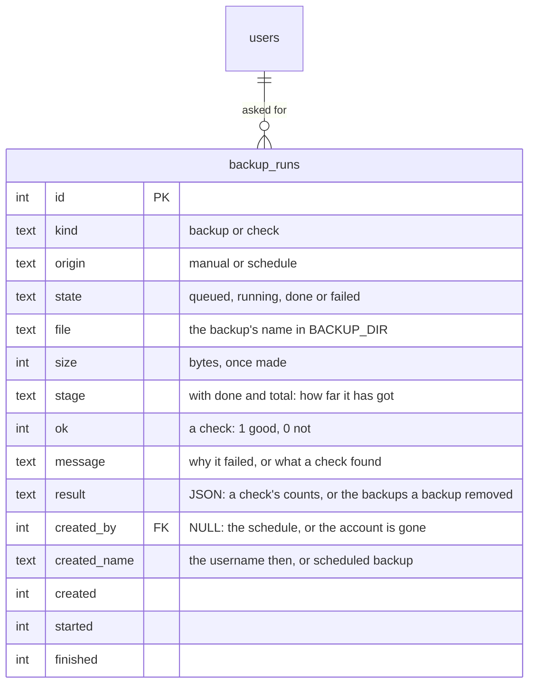

# Database design

Sanguity keeps everything in one SQLite database, `DATA_DIR/sanguity.db`, plus files in the data folder that it
points at (documents, uploads, previews, watch summaries). The schema is built step by step from `SCHEMA` in
[`server/db.py`](../server/db.py): each step is a numbered version (`PRAGMA user_version`), applied once at start-up,
so an older install upgrades itself. This page describes **schema version 28**. When you add a step, update the
diagrams here too.

Two things hold everywhere:

- **Health information is encrypted.** Every column that holds records, document names or secrets is encrypted with
  the data key (`crypto.enc`, AES-256-GCM), marked 🔒 below. Only ids, links between rows, timestamps, states and
  counts are plain. Where a value must be found without decrypting every row, a keyed hash (HMAC) of it is stored
  beside it (`key_hash`, `target`).
- **Everything belongs to a profile, and goes with it.** Deleting a profile removes its records, imports, uploads,
  jobs, edits, same-result links, journal entries, settings, memberships and activity by `ON DELETE CASCADE`. Records also belong to the import that brought them
  in, so undoing an import removes exactly its rows.

## Accounts and access

People sign in as **users**. A **profile** is a person whose health is tracked. **Memberships** link the two with a
role (owner, editor or viewer), so one account can look after several profiles and one profile can be shared.



`meta` (`k`, `v`) holds install-wide values: the pepper for password hashes (encrypted), the setup code's hash, and
one-off migration markers.

## Records and imports

Records come in as **imports**: the setup build, an export loaded with `server.manage import`, an upload from the
browser, or results typed in. A browser upload is stored as raw files (**uploads**, **upload_files**), read by a
background **job** that stops at a preview, and saved as one import once confirmed. An import's **events** (visits,
stays, lab draws, documents, claims…), lab **series** and their **results**, and its **documents** all point back to
it. **Edits** (corrections) belong to the profile instead, keyed by a hash of each event's source key, so they
survive re-imports and undo. So do **same_results**: the person's decision that a lab result from one source is the
same as one from another (shown once, with both sources) or not (no longer flagged), found by both results' point
keys (`server/crossmatch.py`, #96).
survive re-imports and undo. So do **journal** entries (#49, `server/journal.py`): notes, symptoms and side effects
the people using the profile write themselves. They aren't records from anywhere, so no import owns them; the
records the page loads list them as `journal`, and an export carries them in its `data.json`. The medication
timeline (#50, `server/medications.py`) is worked out from the `med` and `rx` events each time the records are put
together and listed as `medications`; it has no table and is never stored from an import. An import's
**name** (schema version 25, #38) is what the person renamed it to, encrypted; the records call it by that wherever
they say where a record came from, and NULL means the importer's label. **cost_marks** (schema version 27, #55,
`server/oop.py`) hold what a person said about an out-of-pocket amount on the Costs tab: a payment or a claim's share
tagged HSA or FSA, a payment matched to a claim (or to none), two look-alike payments said to be two. Like edits they
belong to the profile and find their payment or claim by a keyed hash of its key. (Versions 26 and 27 belong to work
landing alongside.)

```mermaid
erDiagram
    profiles ||--o{ imports : "has"
    imports ||--o{ events : "brought"
    imports ||--o{ series : "brought"
    series ||--o{ results : "holds"
    imports |o--o{ documents : "links"
    profiles ||--o{ uploads : "has"
    uploads ||--o{ upload_files : "holds"
    uploads ||--o{ jobs : "is imported by"
    jobs |o--o| imports : "saved as"
    profiles ||--o{ import_undos : "remembers"
    profiles ||--o{ edits : "has"
    events }o..o{ edits : "matched by key hash"
    profiles ||--o{ same_results : "has"
    results }o..o{ same_results : "matched by point key"
    profiles ||--o{ journal : "has"
    profiles ||--o{ cost_marks : "has"

    profiles {
        int id PK
        int records_rev
    }
    imports {
        int id PK
        int profile_id FK
        int at
        text origin "build | dataset | upload | manual"
        text format "the importer that read it"
        int synced "last sync of a live connection (#91), else NULL"
        text meta "🔒 JSON: source, built, problems, upcoming visits, payments..."
        text name "🔒 what the person calls it (#38), else NULL"
    }
    events {
        int id PK "the id the page sees"
        int profile_id FK
        int import_id FK
        text body "🔒 JSON: time, kind, title, source key..."
        text detail "🔒 JSON: what the drawer shows"
        text cost "🔒 JSON: its Costs row"
        int cost_seq "order on the Costs tab"
        text key_hash "HMAC of the source key"
    }
    series {
        int id PK
        int profile_id FK
        int import_id FK
        text body "🔒 JSON: name, unit, panel, LOINC"
        text key_hash "HMAC of the source key"
    }
    results {
        int id PK
        int profile_id FK
        int import_id FK
        int series_id FK
        text body "🔒 JSON: time, value, range, flag"
    }
    documents {
        text id PK "random, can't be guessed"
        int profile_id FK
        int import_id FK
        text path "🔒 file it serves"
        text ext
    }
    uploads {
        int id PK
        int profile_id FK
        int created_by FK
        int created
        text state "receiving | ready | discarded"
        int files
        int bytes
        text manifest "🔒 JSON: stored name, path, size"
    }
    upload_files {
        int upload_id PK, FK
        text name PK
        text file "random name on disk"
        text path "🔒 path in the upload"
        int bytes
    }
    jobs {
        int id PK
        int profile_id FK
        int upload_id FK
        int created_by FK
        int confirmed_by FK
        text state "queued | running | preview | done | failed | discarded"
        text stage "detecting | parsing | saving"
        text importer
        text message "🔒"
        text warnings "🔒 JSON"
        text summary "🔒 JSON: counts, duplicates, range"
        text keep "duplicates saved anyway"
        text labs "🔒 JSON: lab-name matches chosen at the preview"
        text same "possible matches confirmed as the same result"
        int import_id FK
        int created
        int started
        int finished
    }
    import_undos {
        int id PK
        int profile_id FK
        int import_id "gone, so not a reference"
        int at
        int by_id FK
        text by_name
        text entry "🔒 JSON: what the history showed"
    }
    edits {
        int id PK
        int profile_id FK
        text target "HMAC of the event's key"
        text target_key "🔒 the key"
        text action "hide | rename | date | not_stay | merge"
        text other "merge: the other event's HMAC"
        text other_key "🔒"
        text value "🔒 JSON"
        int created_by FK
        int at
    }
    same_results {
        int id PK
        int profile_id FK
        text pair "HMAC of both point keys"
        text a_key "🔒 one result's point key"
        text b_key "🔒 the other's"
        int same "1 same result, 0 not the same"
        text value "🔒 JSON: both sides when decided"
        int created_by FK
        int at
    journal {
        int id PK
        int profile_id FK
        text body "🔒 JSON: kind (note | symptom | side_effect), date, what, severity 0-10, note, medication"
        int created_by FK
        text created_name "the username then"
        int created
        int changed_by FK
        text changed_name
        int changed
    }
    cost_marks {
        int id PK
        int profile_id FK
        text target "HMAC of the payment's or claim's key"
        text target_key "🔒 the key"
        text value "🔒 JSON: hsa, claim, same"
        int created_by FK
        int at
    }
```

A **point key** is what identifies a lab result across re-imports, as the preview identifies one: the series' source
key (or, without one, its name), the unit, the time and the value as reported. `pair` is
`HMAC(pepper, "sanguity same result\0" + both keys, sorted)`, so a pair is found, and the page refers to it, without
decrypting anything; it is unique per profile, and a second decision on a pair replaces the first. When the records
are put together, a "same result" whose two results are both there shows once (the older import's), with the other's
source listed; when either import is undone the decision stays, unapplied, until it comes back.

## Lab-name matches (install-wide)

When an import's preview finds a lab name that `lab-aliases.json` doesn't know, the person importing matches it to
an existing series or keeps it as its own (`server/labmap.py`). The choice is remembered in **labmaps** and applied to
later imports on every profile of the install, so it belongs to no profile. Rows are looked up by a keyed hash of the
importer, the name as reported, its unit and LOINC code; the name and the series it goes to are encrypted. Only admins
can change or remove one.



## Settings (per profile, per user or per install)

What used to be a `settings.json` per profile (key labs, lab nicknames, workout rules...) is one row per setting in
**settings** (`server/settings.py`, #35). The registry there says, for each setting, whether its value belongs to a
profile (`profile_id` set), to an account (`user_id` set, the same on every profile) or to the whole install
(neither), and who changes it: a profile's owners and editors, the person themself, or admins. The page reads the
merged value: the default, then the install's row, then the profile's, then the user's. A value that can hold health
information (lab names, rules) is encrypted in `sealed`; any other is plain JSON in `value`. `profiles.settings_seeded`
marks a profile whose settings were seeded (from its own `settings.json` at the upgrade, or the setup build's the first
time the build is loaded into it), so a later rebuild never fills one in again.



One row per key and owner (a unique index on `key`, `IFNULL(profile_id, 0)`, `IFNULL(user_id, 0)`).

The `units` setting (#41) is a user's row, plain JSON (`{"lab", "weight", "temperature"}`). The conversions it picks
from aren't stored: each lab series the page loads carries its exact ones (`conv`, from `server/units.py`) when the
records are put together, and the page converts as it draws, keeping what was reported.

Reference ranges from settings (#44, `server/ranges.py`) are three ordinary profile settings, sealed:
`ranges.birthDate` ("" or YYYY-MM-DD), `ranges.sex` ("", "female" or "male") and `ranges.overrides` (a list of
`{lab, unit, sex: "any"|"female"|"male", ageFrom, ageTo, low, high}`, ages in whole years and inclusive, either end
open). No schema step: they are rows like any other setting, applied when the page or the visit summary reads the
records, never written into them.

One key outside the registry lives here too: `summary.questions`, a profile's draft of questions for the visit
summary (`server/summary.py`, #48), always in `sealed`. Not being in the registry, it never shows on the Settings
screen or in a settings export, and it goes with the profile.

## Connected sources

A profile can be connected to a provider's or insurer's FHIR API by signing in to it (#32), and is then kept up to
date on a schedule (#91; `server/connections.py`, `server/smart.py`, `server/sync.py`). How sign-in works is decided
in [connected-sources-oauth.md](connected-sources-oauth.md): each install registers its own app with each vendor.

- **smart_clients** is what an admin set up per source (install-wide): the FHIR base (issuer), the client ID, the
  client secret where the vendor issued one, how the app authenticates and the scopes to ask for, and the discovery
  its last test read. The server contacts no host for that source other than the issuer's and those its discovery
  names for the token, revocation and registration endpoints.
- **connections**: one per profile and source. The access token, the refresh token or (with Epic's dynamic
  registration) the private key and dynamic client ID are one encrypted JSON value, deleted on disconnect, as is the
  patient id. `cursor` is the `_lastUpdated` to ask after, per resource type; `state` is `active`, `needs reconnect`
  (the vendor ended access) or `disconnected` (kept, without credentials, so the count and the history can name it).
- **connect_pending**: a sign-in between leaving for the vendor and coming back, at most 10 minutes. Only a hash of
  `state` is stored; the PKCE verifier is encrypted; it is bound to the session that started it and used up on
  return, whatever the outcome.
- **imports.connection_id**: the connection an import came from (the first pull, then each sync, origin `sync`).
- **sync_changes**: what a sync changed in place (an event, or an entry of an import's profile-wide lists), with what
  it was before, so undoing that sync puts it back. A later sync that changed the same record again inherits the
  "before".

Beside the rows, each connection keeps every FHIR resource it has read, the newest version of each, sealed in
`profiles/<id>/connections/<connection id>` (a lab day is rebuilt from all of them); it is deleted on disconnect.
Each pull's raw answer is kept as an upload, like an import's files.

Schema version 21 adds what a connection pulls and how it warns (#99, #101, #102):

- **connections.kinds** and **since**: the person's choice of records (`connections.KINDS`: labs, vitals, visits,
  problems, medications, documents, claims) and the date to pull from; NULL is everything the access allows, from
  the beginning. **connect_pending** keeps the same two from the start of a sign-in to its return. The cursor's
  keys name each search with its parameters (`Observation?category=laboratory&date=ge2021-01-01`), so a kind turned
  on later is pulled from the beginning; a connection from before version 21 keeps its plain type names.
- **connections.attach**: the connection's own attachment rules (`{auto, max_mb, types, budget_mb}`), over the
  install's settings `sync.*` in **settings**; **attach_bytes**, what it has fetched, for its total.
- **connections.warned**: when the "stopped syncing" warning went into the profile's activity log, so it goes in
  once; cleared when a pull works or the connection is signed in again.
- **sync_skipped**: attachments a pull left out (by its rules), one row per attachment address (a SHA-256 of it);
  the address, its record's source key, title, kind, size and why are encrypted. `import_id` is set once it is
  fetched anyway, by that import, and goes back to NULL (listed again) when that import is undone.
- **sync_removed**: the rows "remove the records of a kind" took out (events, a series with its results, or the
  entries of an import's profile-wide list), encrypted, under the import that removed them. Undoing that import from
  the history puts them back in their own imports, with their ids where those are free.
- **imports.note**: what a sync import that isn't a pull did (removed a kind, or fetched an attachment), encrypted,
  for the history's label and counts.



## Outside contacts

Every request Sanguity's server makes to another host goes through `server/net.py` under a permit from
`server/outside.py` (#97, #59): a connected source's hosts (as its admin-tested discovery names them), or the host of
a SMART Health Link someone confirmed. Each contact is recorded before anything is sent: in the activity log, and in
**outside_contacts** (schema 20), one row per profile, purpose and host with the first and last contact and a count,
for the outside-connections view on the Admin page. Only the host is kept, encrypted (a Health Link's host can say
where someone is treated); never a path, query, token or key. `profile_id` is `NULL` for a contact with no profile
involved (an admin's "Test this connection"); a profile's rows go with it.



## Calendar feeds

A **calendar feed** (`server/calendar.py`, #51) is the private address a person's own calendar app fetches to show the
profile's upcoming appointments and expected lab draws. There is one per person and profile. The address carries a
random token, and only its SHA-256 is kept in `token_hash`, as for sessions. A feed works only while its person can
still view the profile: the membership and the account are checked at every fetch. Fetches aren't logged, only the
time of the last one; making, rotating and revoking a feed are logged in the profile's activity (`calendar`).



One row per profile and user (unique).

## Share links

A **share link** (`server/share_links.py`, #47) lets someone without an account read part of a profile: the
sections, labs and date range an owner chose, read-only, until it expires (at most 90 days) or an owner revokes it.
As for sessions and calendar feeds, only the SHA-256 of the link's token is kept, in `token_hash`. A link works only
while the owner who made it is still an owner with an account that isn't disabled; if that account is removed,
`created_by` becomes `NULL` and the link stops. Every view is counted here and logged in the profile's activity
(`link`, actor "share link", with the viewer's address). Revoked and expired links stay listed for 30 days, then
are deleted.



## Backups (install-wide)

The backups themselves are files in `BACKUP_DIR` (`server/backup.py`); `backup_runs` (schema version 28, #200) is
what the Admin page's **Backups** asked for and how it went: **Back up now**, the schedule's backups (origin
`schedule`, made by "scheduled backup") and **Check a backup**, one row each. `server/backup_jobs.py` runs them in
turn in the background (`queued` → `running` → `done` or `failed`), and the page polls the one running. A check
that ran and found the backup damaged is `done` with `ok` 0 and what it found in `message`. A backup's file is named
before the database is copied, so a database restored from that backup knows its own row; at start-up, rows left
running are marked done if their file was finished, failed otherwise. The newest 100 rows are kept. Nothing here is
health information (file names, sizes, row counts), so nothing is encrypted. The schedule and how many backups to
keep are in `meta` (`backup.schedule`, `backup.keep`).



## What is encrypted

| Table | Encrypted columns |
|---|---|
| `events` | `body`, `detail`, `cost` |
| `series`, `results` | `body` |
| `imports` | `meta`, `note`, `name` |
| `documents` | `path` |
| `uploads` | `manifest` |
| `upload_files` | `path` |
| `jobs` | `message`, `warnings`, `summary`, `labs` |
| `import_undos` | `entry` |
| `edits` | `target_key`, `other_key`, `value` |
| `same_results` | `a_key`, `b_key`, `value` |
| `journal` | `body` |
| `share_links` | `label`, `scope` |
| `cost_marks` | `target_key`, `value` |
| `labmaps` | `source`, `target` |
| `settings` | `sealed` |
| `smart_clients` | `secret` |
| `connections` | `patient`, `secret`, `last_error`, `report` |
| `connect_pending` | `verifier` |
| `sync_changes` | `previous` |
| `sync_skipped` | `detail` |
| `sync_removed` | `row` |
| `activity` | `detail` |
| `outside_contacts` | `host` |
| `users` | `totp_secret`, `totp_pending` |
| `meta` | the pepper |

The list the start-up check and key rotation use is `FIELDS` in [`server/atrest.py`](../server/atrest.py); keep the
two in step. Files the rows point at (documents imported from an export, upload files, previews, imported watch
summaries) are encrypted on disk too. Not encrypted: usernames and profile names (needed for sign-in and
sorting), and your original exports in `RECORDS_DIR`, which Sanguity only reads.

## What a deletion removes

| Deleted | Also removed (cascade) | Kept |
|---|---|---|
| A profile | memberships, imports with all their rows, documents, uploads and their files, jobs, edits, same-result links, journal entries, cost marks, settings, calendar feeds, share links, undo history, its activity and outside contacts | the original exports |
| An import (undo) | its events, series, results and documents; its upload's raw files unless another import uses them | edits, same-result links, journal entries and cost marks (they belong to the profile) |
| An upload | its files and jobs (a job's saved import stays) | the import it became |
| A connection (disconnect) | its tokens, key, patient id and stored resources; its imports too, if chosen; its hosts from "may contact" | the row, as disconnected; its outside contacts, listed as earlier ones |
| An account | sessions, devices, passkeys, recovery codes, memberships, its own settings, its calendar feeds, pending sign-ins | activity, uploads, jobs, journal entries, lab-name matches and share links it made (their links become `NULL`; such a share link stops working) |
