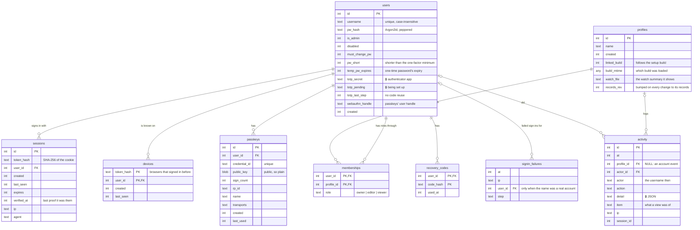
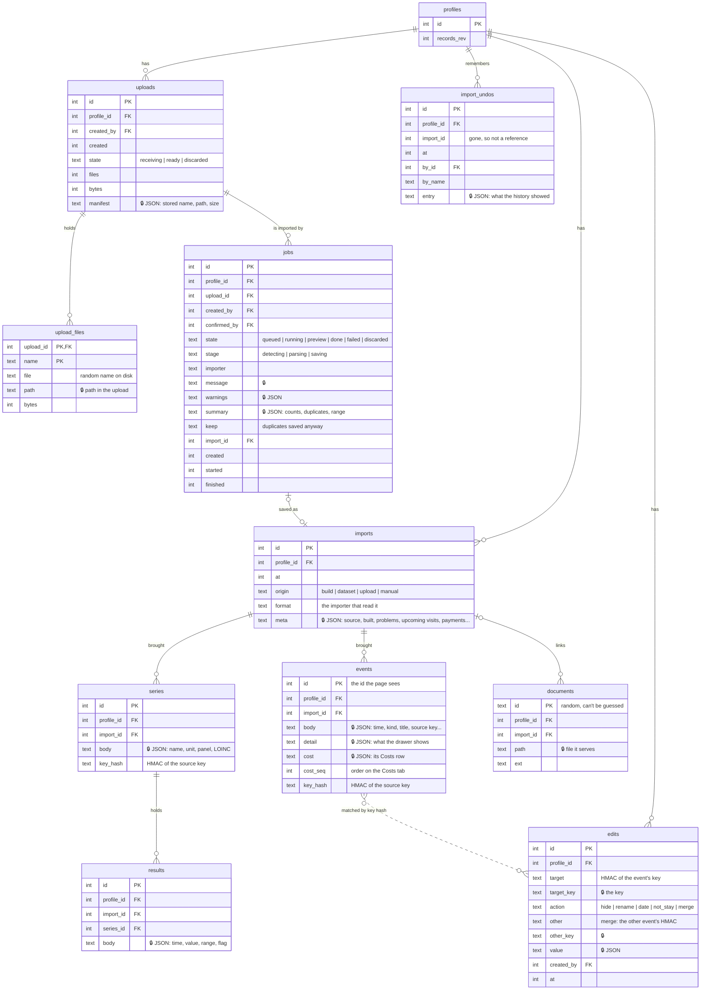

# Database design

Sanguity keeps everything in one SQLite database, `DATA_DIR/sanguity.db`, plus files in the data folder that it
points at (documents, uploads, previews, watch summaries). The schema is built step by step from `SCHEMA` in
[`server/db.py`](../server/db.py): each step is a numbered version (`PRAGMA user_version`), applied once at start-up,
so an older install upgrades itself. This page describes **schema version 15**. When you add a step, update the
diagrams here too.

Two things hold everywhere:

- **Health information is encrypted.** Every column that holds records, document names or secrets is encrypted with
  the data key (`crypto.enc`, AES-256-GCM), marked 🔒 below. Only ids, links between rows, timestamps, states and
  counts are plain. Where a value must be found without decrypting every row, a keyed hash (HMAC) of it is stored
  beside it (`key_hash`, `target`).
- **Everything belongs to a profile, and goes with it.** Deleting a profile removes its records, imports, uploads,
  jobs, edits, memberships and activity by `ON DELETE CASCADE`. Records also belong to the import that brought them
  in, so undoing an import removes exactly its rows.

## Accounts and access

People sign in as **users**. A **profile** is a person whose health is tracked. **Memberships** link the two with a
role (owner, editor or viewer), so one account can look after several profiles and one profile can be shared.

`meta` (`k`, `v`) holds install-wide values: the pepper for password hashes (encrypted), the setup code's hash, and
one-off migration markers.

## Records and imports

Records come in as **imports**: the setup build, an export loaded with `server.manage import`, an upload from the
browser, or results typed in. A browser upload is stored as raw files (**uploads**, **upload_files**), read by a
background **job** that stops at a preview, and saved as one import once confirmed. An import's **events** (visits,
stays, lab draws, documents, claims…), lab **series** and their **results**, and its **documents** all point back to
it. **Edits** (corrections) belong to the profile instead, keyed by a hash of each event's source key, so they
survive re-imports and undo.

## What is encrypted

| Table | Encrypted columns |
|---|---|
| `events` | `body`, `detail`, `cost` |
| `series`, `results` | `body` |
| `imports` | `meta` |
| `documents` | `path` |
| `uploads` | `manifest` |
| `upload_files` | `path` |
| `jobs` | `message`, `warnings`, `summary` |
| `import_undos` | `entry` |
| `edits` | `target_key`, `other_key`, `value` |
| `activity` | `detail` |
| `users` | `totp_secret`, `totp_pending` |
| `meta` | the pepper |

The list the start-up check and key rotation use is `FIELDS` in [`server/atrest.py`](../server/atrest.py); keep the
two in step. Files the rows point at (documents imported from an export, upload files, previews, imported watch
summaries, settings) are encrypted on disk too. Not encrypted: usernames and profile names (needed for sign-in and
sorting), and your original exports in `RECORDS_DIR`, which Sanguity only reads.

## What a deletion removes

| Deleted | Also removed (cascade) | Kept |
|---|---|---|
| A profile | memberships, imports with all their rows, documents, uploads and their files, jobs, edits, undo history, its activity | the original exports |
| An import (undo) | its events, series, results and documents; its upload's raw files unless another import uses them | edits (they belong to the profile) |
| An upload | its files and jobs (a job's saved import stays) | the import it became |
| An account | sessions, devices, passkeys, recovery codes, memberships | activity, uploads and jobs it made (their links become `NULL`) |
